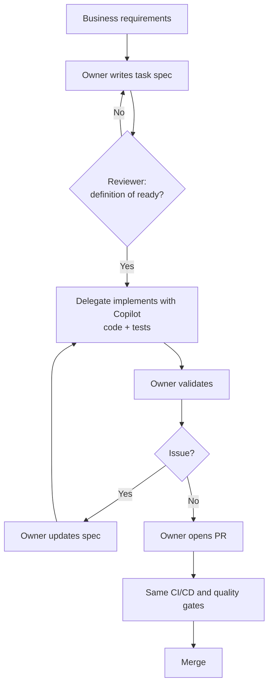

# Sharing Copilot token credits in a team

The idea: a team's Copilot token credits should work as a shared pool, even though each bundle is licensed to one person. When one developer runs out and a teammate still has credits left, the work moves to the credits, not the credits to the person.

This is done with spec-driven development. The developer who is out of credits (or has no license) writes a Markdown task spec. A teammate with credits left implements it with Copilot. The developer who wrote the spec validates the result and opens the pull request. Nobody shares a login or transfers credits.

## Why

Companies usually buy Copilot through a contract with Microsoft/GitHub where each developer has a personal credit limit per billing period: a per-user allowance, or a per-user budget that admins set on the organization's pool. Usage is uneven: some developers hit their limit early, others end the period with credits left over, and some have no license at all. A limit belongs to one user, so leftover credits do nothing for the colleague who ran out.

Those leftover credits are capacity the company has already paid for. Routing work to the people who still have credits gets more out of the same contract, without extra seats, shared logins or license violations.

## How it works

Nobody transfers tokens or accounts. The unit of sharing is a task spec, `docs/backlog/TASK-NNN-short-slug.md`, committed to the repository.

| Role | Does |
|------|------|
| Business | Provides requirements and acceptance criteria |
| Owner | Writes the task spec, validates the result, makes the final commit and opens the PR |
| Reviewer | Approves the task against the definition of ready before any credits are spent |
| Delegate | Implements the task with Copilot, including tests and docs, and hands it back |



The owner does the parts that cost no credits (specifying and validating). The delegate spends credits only on implementation, where Copilot saves the most time. Because the spec, decisions and implementation notes live in the repository, nothing important stays trapped in someone's Copilot chat.

## Spec-driven development and Spec Kit

The process is spec-driven development applied to a team instead of a single developer. In spec-driven development, intent is written down as a structured Markdown spec before any code, and the AI agent plans and implements from that spec. [GitHub Spec Kit](https://github.com/github/spec-kit) packages this as a workflow for Copilot and other agents: `/speckit-constitution` once per project, then `/speckit-specify`, `/speckit-plan`, `/speckit-tasks`, `/speckit-implement` and `/speckit-converge` per feature.

Here, the spec does one more job: it is the handoff between the teammate who has no credits left and the teammate who does. The pieces line up like this:

| Spec Kit step | In this process |
|---------------|-----------------|
| Constitution | `docs/ARCHITECTURE.md`, `CODING_GUIDE.md`, `TESTING_GUIDE.md`, `.github/copilot-instructions.md` |
| Specify | Business requirements in `docs/specs/`, written up by the owner as a task spec |
| Plan, tasks | The task spec in `docs/backlog/`, approved by the reviewer |
| Implement | The delegate runs it with Copilot, spending their credits |
| Converge | The owner validates, and the spec is updated until the result matches it |

Spec Kit is optional. A team can run the process with plain task files and the `implement-task` prompt, or use Spec Kit (`uv tool install specify-cli`, then `specify init . --integration copilot`) to generate and drive the specs.

The full process, including what to delegate, the definition of ready, credit-saving tips and recommended agents and skills, is in the [PRD](docs/spec/PRD-copilot-capacity-sharing.md).

## Repository layout

| Path | Contents |
|------|----------|
| `docs/spec/PRD-copilot-capacity-sharing.md` | The process definition |
| `docs/backlog/` | Task specs, one file per task (see `TASK-042` as an example) |
| `docs/specs/` | Feature design documents referenced by tasks |
| `docs/ARCHITECTURE.md`, `docs/CODING_GUIDE.md`, `docs/TESTING_GUIDE.md` | Example team standards that tasks point to |
| `.github/copilot-instructions.md` | Context Copilot loads on every request |
| `.github/prompts/implement-task.prompt.md` | The prompt a delegate runs to implement a task |

## Try it

1. Copy `docs/backlog/TASK-042-order-summary-report.md` as a template for your own task.
2. Get it reviewed against the definition of ready in the PRD.
3. As the delegate, open Copilot Chat in agent mode and run `/implement-task` with the task file attached.
4. As the owner, validate the result and open the PR.

To reuse it in your own project, copy `docs/spec/`, the task template and the `.github/` files.

## Development

The project is documentation only. Diagrams are PlantUML (`.puml`) and Mermaid (`.mmd`) sources with rendered PNGs next to them.

```bash
make help       # list targets
make diagrams   # render all .puml and .mmd files (needs plantuml; Mermaid runs via npx)
make lint       # markdownlint
make links      # offline link check (needs lychee: brew install lychee)
make slides     # export the Marp deck to PDF and PPTX
```

CI runs the Markdown lint and link check on every push and pull request.

## Author

Wallace Espindola, Solution Architect

- Email: <wallace.espindola@gmail.com>
- LinkedIn: <https://www.linkedin.com/in/wallaceespindola/>
- GitHub: <https://github.com/wallaceespindola/>

## License

[MIT](LICENSE)
