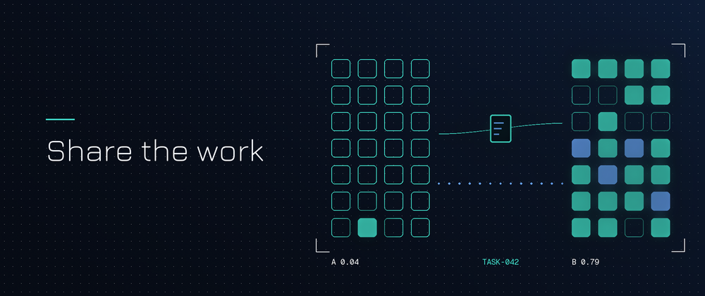
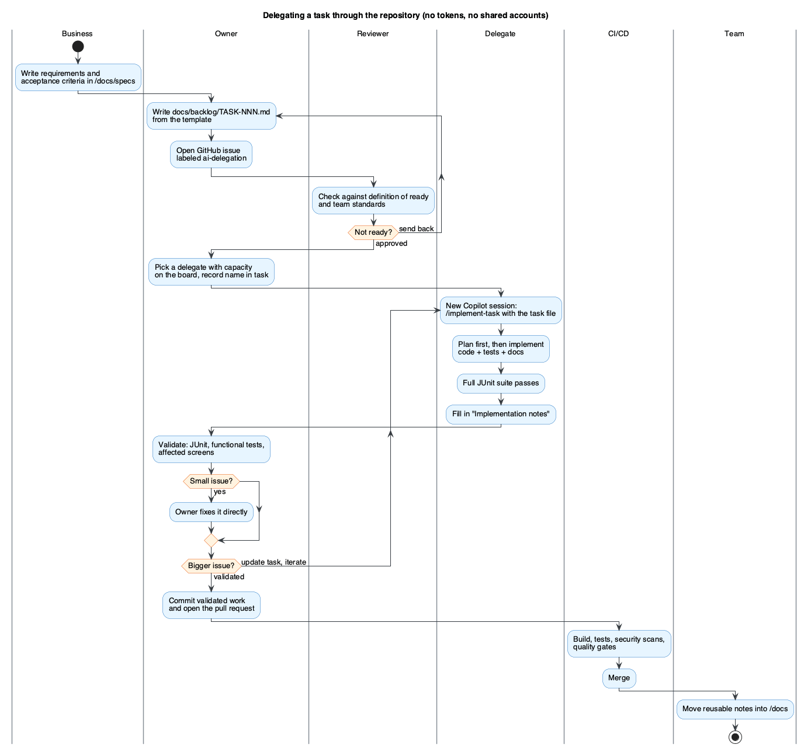
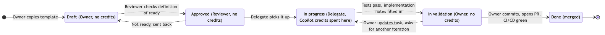

Most teams get Copilot through a company contract with GitHub or Microsoft, and each developer works against a personal limit per billing period: a per-user credit allowance, or a per-user budget that admins set on top of the organization's pool. Usage is uneven. One developer has a small limit and runs out early in the period. Another ends the period with credits left over. A third has no license at all.


A limit belongs to one user, so the leftover credits do nothing for the colleague who ran out. That's capacity the company already paid for, sitting idle. If you route work to the people who still have credits, you get more out of the same contract without buying extra seats. (If your org pools credits with no per-user caps, the credit argument is weaker, but the teammate with no license still needs a way in.)

The informal fix is a chat message: "can you run this through Copilot for me?" It sort of works, once. The context is half in your head, the delegate spends credits on clarifying questions, and everything Copilot learned disappears with the conversation.

So I wrote down a process for doing it properly. The owner of the work writes a Markdown task spec, commits it to the repo, and a teammate with spare Copilot capacity implements it. Nobody transfers tokens or shares a login, and the repo carries the context.

The full proposal and example files are here: [share-tokens-using-spec-driven-dev on GitHub](https://github.com/wallaceespindola/share-tokens-using-spec-driven-dev). This article covers the hands-on part: the files you add to a repo and how a task moves through them.


## This is spec-driven development, with a team around it

If you've used [GitHub Spec Kit](https://github.com/github/spec-kit), the shape will look familiar. Spec-driven development makes the spec the source of truth and treats the AI as the one who implements it. This process keeps that idea and splits the steps between people:

| Spec Kit step | Who does it here |
|---------------|------------------|
| `/speckit-constitution` (once per project) | Team standards in `/docs` plus `.github/copilot-instructions.md` |
| `/speckit-specify` | Owner writes up the business requirements |
| `/speckit-plan`, `/speckit-tasks` | The approved `TASK-NNN.md` file |
| `/speckit-implement` | Delegate's Copilot session |
| `/speckit-converge` | Owner's validation loop, repeated until the work is accepted |

You don't need Spec Kit to run this. Plain Markdown files work fine. If you want the toolkit, it supports Copilot:

```bash
uv tool install specify-cli
specify init my-project --integration copilot
```

In Spec Kit, you repeat implement and converge until converge reports "Converged". Here, the owner's validation plays that role.

## The one rule: nobody shares credentials

Writing a good spec and validating the result cost zero AI credits. Implementation is where Copilot saves the most time. So the split is:

- The **owner** does the thinking and the checking: writes the task, validates the result, makes the final commit and opens the PR.
- The **delegate** spends credits on the one part that benefits most: implementation, tests and docs.
- A **reviewer** (architect, tech lead or another developer) approves the task before anyone spends a credit.

Upstream of all three, the business side (a product owner or analyst) writes the requirements and acceptance criteria, ideally in the existing `docs/specs`.

The owner stays responsible for what gets merged, and the delegate never needs access they don't already have. Delegated code goes through the same review, CI/CD and quality gates as any other change.

Here is the whole flow, one swimlane per role:



There are two loops in there. A task the reviewer rejects goes back to the owner before any credits are spent. A result that fails validation goes back to the delegate, but only after the owner fixes the task file, because a retry against the same spec will usually produce the same mistake.

## The repo layout

Everything lives in the repository. A Copilot conversation is gone when the session ends, while the files stay in git history.

```text
.github/
  copilot-instructions.md          # loaded into Copilot requests in this repo
  instructions/
    tests.instructions.md          # path-specific rules (applyTo glob)
  prompts/
    implement-task.prompt.md       # the shared /implement-task prompt
  agents/
    ready-check.agent.md           # optional: reviewer persona
docs/
  ARCHITECTURE.md
  CODING_GUIDE.md
  TESTING_GUIDE.md
  specs/report-generation/design.md
  backlog/
    TASK-042-order-summary-report.md
AGENTS.md                          # same guidance for other coding agents
```

Per GitHub's docs, repository instructions go in `.github/copilot-instructions.md`, path-specific ones in `.github/instructions/*.instructions.md`, custom agents in `.github/agents/*.agent.md` and skills in `.github/skills/<name>/SKILL.md`. Prompt files live in `.github/prompts/` as `*.prompt.md` and are documented by VS Code. Support differs between IDEs and the cloud agent, so check the docs for the surface your delegates use.

## Step 1: the task file

One file per task, named `docs/backlog/TASK-NNN-short-slug.md`. `NNN` is zero-padded and never reused. Each task also gets a GitHub issue labeled `ai-delegation` that links the file, so the issue board shows what is waiting and who picked up what.

Here is the example from the repo, `TASK-042-order-summary-report.md`:

```markdown
# TASK-042: Generate order summary report

Status: Draft | Approved | In progress | In validation | Done
Owner: <name>
Reviewer: <name>
Delegate: <name>
Issue: <link>

## Objective
Generate the order summary report from normalized order records.

## Tech stack
- Java 25, Spring Boot, PostgreSQL
- Kafka where required

## Expected behavior
1. Load the report configuration.
2. Retrieve the eligible orders.
3. Generate the report.
4. Store the delivery metadata.

## Architecture constraints
- Follow ../ARCHITECTURE.md and ../CODING_GUIDE.md.
- Do not bypass the defined service boundaries.

## Acceptance criteria
- [ ] The report is generated for all eligible orders.
- [ ] The job can be restarted after a failure.
- [ ] A failed run is recorded.
- [ ] Unit tests cover the new code.
- [ ] Integration tests cover the end-to-end flow.

## Out of scope
- File transport
- Customer notification

## References
- ../TESTING_GUIDE.md
- ../specs/report-generation/design.md

## Implementation notes
Filled in by the delegate at handback.
- Changed:
- Decisions:
- Open questions:
```

A few sections pull more weight than they look like they should:

- **Out of scope** keeps Copilot from wandering. Without it, "generate the report" can easily turn into "generate and email the report".
- **References** point at real files. The design doc for TASK-042 already describes the `report_run` table and the restart rule (skip a completed run with the same configuration and period), so the task doesn't repeat it.
- **Implementation notes** is empty on purpose. The delegate fills it in at handback (more on that below).

## Step 2: the definition of ready

Copilot burns credits fastest when it has to guess. The reviewer approves a task only when every box is ticked:

```markdown
- [ ] The objective fits in one or two sentences.
- [ ] Each expected behavior is a concrete step, not a wish.
- [ ] Each acceptance criterion can be checked by a test or a visible result.
- [ ] Out of scope is listed.
- [ ] Every referenced doc exists and is current.
- [ ] Input and output examples are included where the format matters.
- [ ] No secrets, credentials or production data.
- [ ] Small enough for one session (a PR one person can review in under an hour).
```

The last item is the easiest one to skip. If the task won't fit in one reviewable PR, split it into TASK-043 and TASK-044 before anyone starts.

Not everything is worth delegating, either. Every delegated task pays for a spec, a review, a handoff and a validation. That overhead pays off for new endpoints, services or jobs with a clear spec, test suites for existing code, mechanical refactors across many files, and boilerplate like DTOs, mappers and migrations. Keep one-line fixes, exploratory design work and live incidents with the owner.

If you want help with the review, a custom agent can run the checklist. A minimal `.github/agents/ready-check.agent.md`:

```markdown
---
name: ready-check
description: Checks a TASK-NNN.md file against the definition of ready before credits are spent.
---
You review task files in docs/backlog/. Do not edit code.
For the given task, check each item of the definition of ready in
docs/spec/PRD-copilot-capacity-sharing.md section 8.
Report each item as PASS or FAIL with one line of reasoning,
then list the questions the owner must answer before approval.
```

`description` is the only required frontmatter field for a custom agent. The human reviewer still makes the call; the agent just catches the obvious gaps.

## Step 3: repository instructions

`.github/copilot-instructions.md` holds the conventions every request should know about, so no delegate has to re-explain them in chat:

```markdown
# Copilot instructions

## Stack
Java 25, Spring Boot, Maven, PostgreSQL. Kafka only where a task says so.

## Read before changing code
- docs/ARCHITECTURE.md: service boundaries and layering (api -> service -> repository/client)
- docs/CODING_GUIDE.md: records for DTOs, constructor injection, 120-char lines
- docs/TESTING_GUIDE.md: JUnit 5 + Mockito, Testcontainers for integration tests

## Rules
- A layer never calls the layer above it. No business logic in controllers.
- Schema changes go through versioned migrations, never manual DDL.
- No hardcoded secrets or environment-specific values.
- Every acceptance criterion in a task maps to at least one test.
- When working from docs/backlog/TASK-*.md, stay inside its "Out of scope" limits.
```

Keep it short. It rides along with every request in the repo, so each line you add is context you pay for again and again. Rules that only matter for tests or migrations go into a path-specific file with an `applyTo` glob:

```markdown
---
applyTo: "src/test/**"
---
Use JUnit 5 and Mockito. Integration tests use a real PostgreSQL via Testcontainers.
Name tests after the behavior: shouldSkipCompletedRunForSamePeriod().
Never retry a flaky test until it passes; fix it or remove it.
```

## Step 4: the shared implement-task prompt

This is the file that makes every delegate run tasks the same way. Save it as `.github/prompts/implement-task.prompt.md`:

```markdown
---
description: Implement a TASK-NNN.md file from docs/backlog end to end
agent: agent
argument-hint: Path to the task file, e.g. docs/backlog/TASK-042-order-summary-report.md
---
You are implementing the task in ${input:task:docs/backlog/TASK-NNN-slug.md}.

1. Read the task file and every document listed under References.
   Read .github/copilot-instructions.md conventions as binding.
2. If Status is not "Approved", stop and say so.
3. Produce a short plan: files to create or change, tests per acceptance
   criterion. Wait for my confirmation before editing.
4. Implement the plan. Respect "Architecture constraints" and "Out of scope".
5. Run the full test suite (mvn verify). Fix failures until all tests pass.
   If you fail twice on the same error, stop and explain instead of retrying.
6. Fill in "Implementation notes" in the task file:
   - Changed: files and what changed
   - Decisions: choices not dictated by the task, with reasons
   - Open questions: anything the owner must decide
7. Set Status to "In validation". Do not commit or open a PR.
```

The delegate types `/implement-task` in Copilot Chat, passes the task path, and gets the same plan-first, test-gated run every time. Step 3 makes Copilot stop after the plan, because a wrong plan caught early costs one request while a wrong implementation costs many. Step 7 keeps the commit and the PR with the owner, who is still responsible for the change.

`${input:...}` is the prompt-file syntax for asking the user for a value, and `agent: agent` runs the prompt in agent mode so Copilot can edit files and run the build.

## Step 5: the handback

When the delegate is done, the task file explains what happened. A filled-in section might look like this (illustrative, not from a real run):

```markdown
## Implementation notes
- Changed: ReportJob, ReportRunRepository, V7__report_run.sql migration,
  ReportJobTest, ReportJobIT (Testcontainers).
- Decisions: Restart check queries report_run by configuration and period
  in SQL, per CODING_GUIDE ("filter in SQL, not in Java").
- Open questions: Should a run stuck in STARTED for more than a day count
  as failed? The design doc does not say.
```

Then the owner validates: JUnit, functional or simulation tests, the affected screens. Small issues they fix themselves. Anything bigger means updating the task file (usually that open question becomes a new acceptance criterion) and sending it back for another iteration. When it's clean, the owner commits, links the task file in the PR, and CI/CD runs its usual gates.

The task's `Status` line tracks all of this, and only one state spends credits:



Last step: anything worth keeping from the implementation notes (a decision, a gotcha) moves into `/docs`. If it only exists in a Copilot conversation, the next delegate won't see it.

## Making the delegate's credits last

For background: GitHub [announced that Copilot plans move to usage-based billing from June 1, 2026](https://github.blog/news-insights/company-news/github-copilot-is-moving-to-usage-based-billing/), with a monthly allotment of GitHub AI Credits consumed by tokens at each model's listed rate. Code completions don't draw on credits. Agent work does. That's why session hygiene matters:

- One task per session, started fresh. Long sessions drag old context into every new request.
- Reference files, don't paste them. Use `#file` or Markdown links in the prompt instead of copying code into chat.
- Plan before editing. The `implement-task` prompt enforces this.
- Use a cheaper model for routine steps (boilerplate, renames, simple tests) and a stronger one only for the hard parts. Model rates change, so check the current pricing in GitHub's docs rather than trusting a number in a blog post, including this one.
- When Copilot loops, stop and fix the task. Retrying the same prompt over and over is an expensive way to find out the spec was ambiguous.

The same habits help owners stretch their own small allowance.

## The cloud agent route

Instead of working in the IDE, a delegate can assign the task's GitHub issue to the Copilot cloud agent, which works in the background and opens a draft PR. The owner then validates that draft PR exactly like a local handback. Two things to know before you do this. Per GitHub's docs, cloud agent sessions also use GitHub Actions minutes, shared with the rest of the account's workflows. And which allowance the AI usage counts against depends on how your organization bills Copilot, so check your billing setup before you count on it landing on the delegate's credits and not the owner's.

## Public tools worth installing

All public, all installed in the repo so every delegate gets the same setup:

- [GitHub Spec Kit](https://github.com/github/spec-kit). The owner can draft the spec and plan with it before turning them into a task file (mapping above).
- [awesome-copilot](https://github.com/github/awesome-copilot). Community instructions, prompts, custom agents and skills, including Java, Spring Boot and JUnit ones. Copy what fits rather than writing from scratch.
- [anthropics/skills](https://github.com/anthropics/skills) and [addyosmani/agent-skills](https://github.com/addyosmani/agent-skills). Skills in the open Agent Skills format (spec-driven development, TDD, code review). Drop them into `.github/skills/<name>/SKILL.md`.
- [GitHub MCP server](https://github.com/github/github-mcp-server). Lets Copilot read the task's issue, linked PRs and CI results.
- [Context7](https://github.com/upstash/context7). Current library docs, so Copilot doesn't write against an outdated Spring Boot API.
- [Playwright MCP](https://github.com/microsoft/playwright-mcp). Drives the UI to check screens, which helps the delegate before handback and the owner during validation.
- Copilot code review, for an automated first pass on the PR before the human review.

## Things that will trip you up

**Secrets in task files.** A task file is committed and read by people and models. Use synthetic examples, never production data or credentials. The definition of ready has a checkbox for this; don't skip it.

**Stale references.** If `design.md` describes last quarter's schema, Copilot will happily implement last quarter's schema. That is why "every referenced doc exists and is current" sits in the checklist.

**Too many iterations.** If a task needs more than two round trips, it usually wasn't ready. Look at the template and the review before blaming the delegate.

**Company policy.** Use Copilot inside your organization's approved AI settings (public code filtering, content exclusions). This process doesn't grant anyone access they didn't already have, and it shouldn't be used to route around policy.

## Recap

- The owner writes `TASK-NNN.md`, a reviewer approves it against the definition of ready, and only then does a delegate spend credits.
- A shared `implement-task.prompt.md` and `.github/copilot-instructions.md` mean every delegate runs a task the same way.
- The delegate hands back passing tests plus filled-in implementation notes. The owner validates, commits and opens the PR.
- No tokens, accounts or licenses move between people. Only the task file does.

## Try it yourself

Clone [the repo](https://github.com/wallaceespindola/share-tokens-using-spec-driven-dev), copy `docs/backlog/TASK-042-order-summary-report.md` as your template, add the prompt file and instructions above to `.github/`, and run one small task through the loop with a teammate. The full process, including what to measure per sprint (tasks merged, iterations per task, queue length), is in `docs/spec/PRD-copilot-capacity-sharing.md`.

How does your team handle uneven Copilot capacity today? Chat messages, pairing, or something more structured? I'd like to hear in the comments.

*I wrote this article with AI assistance, then reviewed, fact-checked and edited it myself.*

**Examples repository:** every example in this article (the PRD, the TASK-042 task spec, the team guides, the Copilot instructions, the prompt file and the diagrams) is in <https://github.com/wallaceespindola/share-tokens-using-spec-driven-dev>.

Need more tech insights?
Check out my GitHub, LinkedIn, and Speaker Deck.
Happy coding!

Wallace Espindola, Solution Architect

- GitHub: <https://github.com/wallaceespindola/>
- LinkedIn: <https://www.linkedin.com/in/wallaceespindola/>
- Speaker Deck: <https://speakerdeck.com/wallacese>
