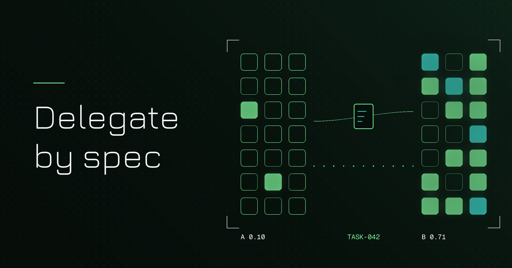
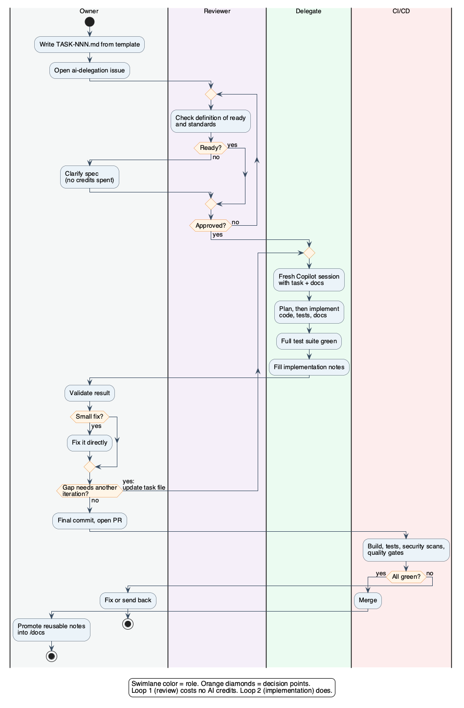

# Spec-driven delegation: governing uneven AI coding capacity



**Author**: Wallace Espindola, Solution Architect
**Email**: <wallace.espindola@gmail.com>
**LinkedIn**: <https://www.linkedin.com/in/wallaceespindola/>
**GitHub**: <https://github.com/wallaceespindola/>
**Companion repo**: <https://github.com/wallaceespindola/share-tokens-using-spec-driven-dev>

---

AI coding capacity rarely lands evenly across a team. Copilot usually arrives through a company contract where each developer works against a personal limit per billing period: a per-user credit allowance, or a per-user budget that admins set on top of the organization's pool. Some developers burn through theirs in the first week. Others end the period with credits left over, and some have no license at all. Each limit belongs to one person, so the leftover credits do nothing for the colleague who ran out. That is capacity the company has already paid for, sitting idle next to people who could use it.

The usual workaround is a favor in a chat window: "Can you run this through Copilot for me?" It works once. As a habit it breaks down quickly. The request carries half the context, the colleague spends their own allowance asking clarifying questions, nobody reviews what was asked for, and whatever was decided lives in a Copilot conversation that nobody else will ever read.

I wanted something sturdier, so I wrote it down as a process and put it in a [companion repository](https://github.com/wallaceespindola/share-tokens-using-spec-driven-dev): a PRD for the process itself, a task template, an example task (`TASK-042`), and the architecture, coding and testing guides the task points to. This article is about the governance side of that proposal: who is responsible for what, where the quality gates sit, how accountability is kept, and how you would tell whether it is working. It describes a proposed process. I don't have adoption numbers from a live rollout, and I won't invent any.

## The model in one paragraph

A developer who owns a piece of work but lacks AI capacity (the **owner**) writes a task specification as a Markdown file in the repository. A **reviewer** checks it against a definition of ready. A colleague with spare Copilot capacity (the **delegate**) implements it with Copilot, runs the tests and writes implementation notes back into the same file. The owner validates the result, makes the final commit and opens the pull request, which goes through the same CI/CD pipeline as everything else.

One rule underpins all of it: **nobody transfers tokens, credits, licenses or accounts**. The delegate uses their own seat for work assigned to them through the normal tracker, and the only thing that moves between people is a specification.

### Where spec-driven development and Spec Kit fit

The process is spec-driven development applied to a staffing problem. In spec-driven development, a written specification comes first and the code is generated from it, so the spec stays the reference when the code is reviewed or changed. [GitHub Spec Kit](https://github.com/github/spec-kit) packages that approach as a set of agent commands. You run `/speckit-constitution` once per project, then `/speckit-specify`, `/speckit-plan`, `/speckit-tasks` and `/speckit-implement` for each feature, followed by `/speckit-converge`. Implement and converge repeat until converge reports "Converged". Spec Kit supports Copilot directly: install the CLI with `uv tool install specify-cli` and run `specify init <project> --integration copilot`.

In Spec Kit, one person drives every step. This process splits the same steps across roles, and the spec becomes the handoff between two people as well as the input to the agent:

| Spec Kit step | In this process | Who |
| --- | --- | --- |
| Constitution | Team standards in `/docs` and `.github/copilot-instructions.md` | Team, maintained by tech leads |
| Specify | Business requirements written up as a task | Owner, from the business input |
| Plan and tasks | The approved `TASK-NNN.md` file | Owner writes it, reviewer approves it |
| Implement | The Copilot session that spends credits | Delegate |
| Converge | The validation loop until the result matches the spec | Owner, with the delegate for more iterations |

Teams already using Spec Kit can keep its commands and add the role split. Teams that aren't can use the plain Markdown template from the companion repo and get the same structure.

## Roles and responsibilities

A process that spans two people and an AI needs explicit ownership, or every failure turns into "I thought you checked that". The PRD defines four roles. The table below turns them into a RACI matrix (Responsible, Accountable, Consulted, Informed) across the steps of one task.

| Activity | Business | Owner | Reviewer | Delegate | CI/CD |
| --- | --- | --- | --- | --- | --- |
| Requirements and acceptance criteria | R/A | C | I | | |
| Write `TASK-NNN.md` and open the issue | C | R/A | | | |
| Check the definition of ready | | C | R/A | | |
| Choose a delegate | | R/A | | C | |
| Implement with Copilot (code, tests, docs) | | A | | R | |
| Run the full test suite before handback | | A | | R | |
| Fill in implementation notes | | A | | R | |
| Validate the result | C | R/A | | C | |
| Final commit and pull request | | R/A | | | |
| Build, tests, scans, quality gates | | I | | | R |
| Promote reusable notes into `/docs` | | R/A | C | C | |

Look at the Owner column. Apart from the requirements, the readiness check and the pipeline itself, every row has an "A" there. The owner is accountable for the task from the moment it is written until it merges, including the steps the delegate performs. If accountability followed whoever held a Copilot license, it would move from person to person with each task. The owner knows the domain, wrote the spec, and will maintain the code afterwards, so the owner signs off.

The reviewer's role is narrow on purpose. They don't review code at this stage. They review the specification before anybody spends credits on it. Code review still happens later on the pull request, through whatever review rules the repository already enforces.


*Figure 1: One delegated task end to end. The readiness review happens before any AI credits are spent.*

**Legend**

| Color | Participant |
| --- | --- |
| Blue | Owner, accountable for the task |
| Purple | Reviewer, gatekeeper for the specification |
| Green | Delegate, the only role that spends credits |
| Yellow | Copilot in agent mode |
| Orange | Git repository (`/docs/backlog`) |
| Red | CI/CD pipeline |

## The specification is the interface

Treat the task file the way you would treat an API contract between two services. Each side can work without knowing the other's internals, as long as both honor the contract. Here the two sides happen to be a person and a person-plus-AI, and the contract is a Markdown file under version control.

This is the core of `TASK-042` from the companion repo:

```markdown
# TASK-042: Generate order summary report

Status: Approved
Owner: <name>
Reviewer: <name>
Delegate: <name>
Issue: <link>

## Objective
Generate the order summary report from normalized order records.

## Expected behavior
1. Load the report configuration.
2. Retrieve the eligible orders.
3. Generate the report.
4. Store the delivery metadata.

## Architecture constraints
- Follow [ARCHITECTURE.md](../ARCHITECTURE.md).
- Follow [CODING_GUIDE.md](../CODING_GUIDE.md).
- Do not bypass the defined service boundaries.

## Acceptance criteria
- [ ] The report is generated for all eligible orders.
- [ ] The job can be restarted after a failure.
- [ ] A failed run is recorded.
- [ ] Unit tests cover the new code.
- [ ] Integration tests cover the end-to-end flow.

## Out of scope
- File transport
- Customer notification

## References
- [TESTING_GUIDE.md](../TESTING_GUIDE.md)
- [Report generation design](../specs/report-generation/design.md)

## Implementation notes
Filled in by the delegate at handback.
- Changed:
- Decisions:
- Open questions:
```

Each section maps to a familiar contract term:

- **Objective and expected behavior** are the operation's signature. They say what the work does, in steps that can be checked.
- **Architecture constraints** are invariants. In the example repo, `ARCHITECTURE.md` says a layer never calls the layer above it and services never read each other's tables. A constraint stated once in a guide and referenced from every task survives far better than one repeated in a chat prompt.
- **Acceptance criteria** are postconditions. The testing guide requires each criterion to map to at least one test, which turns the contract into something a machine can partly verify.
- **Out of scope** prevents scope creep. An AI agent with file-system access will happily "improve" adjacent code. Telling it in writing what not to touch is cheaper than reverting it later.
- **References** are the context window, made explicit. The delegate points Copilot at these files instead of pasting their content.
- **Implementation notes** are the response payload: what changed, what was decided, and what is still open.

The status field (`Draft`, `Approved`, `In progress`, `In validation`, `Done`) gives the file a small lifecycle. Each task also gets a GitHub issue with an `ai-delegation` label that links the file, so the issue board shows which tasks are waiting for a delegate and who has taken which. The file holds the content and the issue handles the workflow, so the two don't compete.

## Definition of ready as a quality gate

In this model the scarce resource is the delegate's AI allowance, plus their time. Both get wasted the same way: the agent has to guess, guesses wrong, and the delegate burns credits steering it back. An agent guesses when the spec leaves a gap, and gaps are cheapest to close before anyone starts a session. So the process puts a gate in front of the expensive step, the same way a pipeline runs cheap checks before expensive ones.

The reviewer approves a task only when all of these hold:

- The objective fits in one or two sentences.
- Each expected behavior is a concrete step, not a wish.
- Each acceptance criterion can be checked by a test or a visible result.
- Out of scope is listed.
- Every referenced document exists and is current.
- Input and output examples are included where the format matters.
- The task contains no secrets, credentials or production data.
- The task fits one session. As a rule of thumb, it should produce a PR one person can review in under an hour. Bigger work is split.

None of these items requires AI capacity. The owner, who by definition is short on credits, does the parts of the job that don't consume them: thinking, specifying and later validating. The credits go to the implementation, where an agent saves the most typing.



*Figure 2: Two loops. The review loop is cheap and can run as often as needed. The implementation loop consumes credits, so the first loop exists to keep the second one short.*

**Legend**

| Element | Meaning |
| --- | --- |
| Swimlane color | Role performing the step |
| Orange diamond | Decision point |
| Upward return arrow | Loop back to an earlier step |

The second loop has a rule of its own. When the owner finds a gap during validation, small fixes are done directly. Anything bigger goes back into the task file first and only then to the delegate. That keeps the spec in sync with what was built, and it stops the iteration from sliding back into an untracked chat thread.

## Ownership and the same gates for everyone

Two design choices keep delegated work from becoming a second-class citizen.

First, the owner validates and the owner opens the pull request. The delegate hands back a branch with passing tests and filled-in notes and never merges it. The owner runs the unit and integration tests, any functional or simulation tests, and checks the affected screens. Then the owner makes the final commit. When a production issue shows up six months later, the PR history points to someone who understood the change well enough to sign for it.

Second, there is no AI lane in the pipeline. Delegated work passes the same build, tests, security scans and quality gates as anything else, and merges only if all of them pass. It can be tempting to relax review for "simple generated code". The PRD rules that out as a non-goal: the process must not change existing CI/CD, review or quality-gate rules. Gates that are adequate for human-written code should hold for agent-written code too. If they don't, they had gaps before any agent showed up.

A variant works with the same governance. Copilot cloud agent (which GitHub's documentation earlier called the coding agent) can [start work from a GitHub issue](https://docs.github.com/en/copilot/concepts/agents/coding-agent/about-coding-agent), work in the background in its own environment and open a pull request. A delegate can start that session from the task's issue. The owner then validates the agent's PR exactly as they would validate a branch from a colleague. GitHub's own docs say the session logs "do not replace your own review and testing", which matches the model.

## Knowledge retention: /docs versus chat history

The informal favor also loses knowledge. Every clarifying exchange, every rejected approach and every assumption the agent made lives in a session that ends.

The model counters this with a simple rule from the PRD: the repository is the source of truth, and nothing needed to understand a task exists only in a Copilot conversation. In practice that rule rests on three layers of version-controlled artifacts.


*Figure 3: Repository artifacts that carry the process. Standing docs change slowly, task files change per unit of work, and the `.github` configuration shapes how the AI behaves for every delegate.*

**Legend**

| Color | Artifact type |
| --- | --- |
| Light blue | Standing documentation (`/docs`, `/docs/specs`) |
| Amber | Task specification (`/docs/backlog`) |
| Green | Copilot configuration (`.github`) |
| Red | Quality gate (CI workflow) |
| Purple | Tracking (GitHub issue) |

The `.github` layer keeps delegates consistent. Without it, every delegate brings their own habits and prompts, and the output varies with whoever picks up the task. GitHub [documents](https://docs.github.com/en/copilot/how-tos/configure-custom-instructions/add-repository-instructions) a repository-wide instructions file at `.github/copilot-instructions.md`, path-specific instructions in `.github/instructions/NAME.instructions.md` (each with an `applyTo` glob), and `AGENTS.md` files that agents read. Reusable [prompt files](https://code.visualstudio.com/docs/agent-customization/prompt-files) live in `.github/prompts` with a `.prompt.md` extension and are available in VS Code, Visual Studio and JetBrains IDEs.

The companion repo ships both files. The repository instructions tell Copilot that the task file is the only source of requirements:

```markdown
<!-- .github/copilot-instructions.md (excerpt) -->
## When implementing a task

- The task file in `docs/backlog/TASK-NNN-*.md` is the only source of requirements.
  Do not add behavior it does not ask for, and respect its "Out of scope" list.
- Follow `docs/ARCHITECTURE.md`, `docs/CODING_GUIDE.md` and `docs/TESTING_GUIDE.md`.
- Every acceptance criterion maps to at least one test. Run the full test suite before handing back.
- Fill in the task's "Implementation notes" section: what changed, decisions made, open questions.
- If the task is ambiguous, stop and list the questions instead of guessing.
```

The shared `implement-task` prompt gives every delegate the same procedure, so nobody re-explains the conventions and every handback looks the same:

```markdown
---
description: Implement an approved TASK-NNN.md spec as a delegate, then hand it back to the owner
agent: agent
---

You are the delegate for the task file given in the input
(for example `#file:docs/backlog/TASK-042-order-summary-report.md`).

1. Read the task file and every document in its "References" and "Architecture constraints" sections.
2. Check the task against the definition of ready in `docs/spec/PRD-copilot-capacity-sharing.md`.
   If anything is missing or ambiguous, stop and list the questions for the owner. Do not implement.
3. Propose a short plan: files to create or change, and which test covers each acceptance criterion.
   Wait for confirmation.
4. Implement the plan: code, unit tests, integration tests and documentation updates. Stay inside the task's scope.
5. Run the full test suite. Fix failures, including existing tests you broke.
6. Fill in the task's "Implementation notes" (Changed, Decisions, Open questions)
   and set its status to "In validation".
7. Summarize the result for the owner in five lines or fewer.
```

In step 2 the prompt re-checks the definition of ready before writing any code, so a spec that slipped past the reviewer gets stopped at the cost of one short exchange instead of a full implementation. Step 3 makes "plan first" part of the procedure instead of leaving it to each delegate's discipline.

The last step of the process closes the loop on knowledge: after merge, the team moves anything worth reusing from the implementation notes into `/docs`. A decision about restart semantics, for example, belongs in `specs/report-generation/design.md`, where the next task can reference it.

## Spending credits deliberately

GitHub changed how Copilot usage is metered during 2026. Since June 1, 2026, plans are [billed by usage](https://github.blog/news-insights/company-news/github-copilot-is-moving-to-usage-based-billing/): GitHub AI Credits, consumed according to token usage, replaced premium requests as the billing unit (premium requests survive only on some legacy plans), and code completions are not billed in credits. Plan details and allowances keep moving, so I won't quote them here. Check the [Copilot billing docs](https://docs.github.com/en/billing/concepts/product-billing/github-copilot-billing) for your plan.

From the organization's point of view, the credits form one budget, but per-user allowances or per-user budgets split it into personal limits. The process doesn't change whose limit is whose. It changes where the work goes, so a developer with room left can serve a colleague who has hit their limit, without buying extra seats. Where an organization pools credits with no per-user caps, that argument is weaker, but developers without a license still need this route.

Whatever the unit, the process treats credits as a budget and shapes sessions to match:

- Run one task per session, started fresh. Long sessions drag old context along, and token-based billing charges for it.
- Reference files instead of pasting them. Point Copilot at the task file and its references (`#file`, `#codebase` in VS Code chat) rather than copying content into the prompt.
- Plan before editing. The shared prompt stops after the plan. A wrong plan caught early costs one exchange. A wrong implementation costs many.
- Match the model to the step. Routine steps (boilerplate, renames, simple tests) rarely need the most expensive model. Check current model rates before choosing, since they change.
- Stop loops early. If the agent keeps circling, the spec is the problem. Fix the task file instead of retrying.

The same habits help owners stretch their own small allowance.

## Security and policy

Delegation doesn't widen anyone's access. The delegate already has repository access through the normal permissions, and the process grants nothing new. Three rules keep it that way:

- Task files never contain secrets, credentials or production data. Use synthetic examples. Task files are committed and readable by everyone with repo access, and they are fed to an AI tool.
- Copilot is used only within the organization's approved AI policy and settings, such as content exclusions and public code filtering.
- Work the delegate's role could not normally touch stays with the owner. "Needs access the delegate lacks" is one of the explicit reasons not to delegate.

There is one question I would put to the organization's licensing or legal contact before rollout, not answer myself: does having one seat holder implement work owned by a colleague fit your agreement and internal policy? Structurally the delegate is just working an assigned ticket with their own tool, which is ordinary teamwork. Still, a short written confirmation is cheaper than an awkward conversation later.

## Measuring whether it pays off

A process without signals turns into ritual. The PRD proposes a small set of per-sprint measures. None of them needs new tooling, and each one answers a specific question.

| Signal | Question it answers | Warning sign |
| --- | --- | --- |
| Tasks delegated and merged | Is the process being used at all? | Many delegated, few merged |
| Iterations per task | Was the spec actually ready? | More than two iterations on a regular basis |
| Time from approval to merge vs. similar hand-built tasks | Does delegation save time end to end? | Delegated tasks consistently slower |
| Tasks waiting for a delegate | Is capacity matched to demand? | Queue growing sprint over sprint |
| Credits left unused at period end | Is paid capacity reaching real work? | Delegates finish periods with large balances while tasks wait |
| Credits consumed per delegated task | Are sessions efficient? | High spend on tasks that needed many iterations |

Most of this comes straight from GitHub. For example, approval-to-merge time can be approximated from the `ai-delegation` issues:

```bash
# Closed delegation issues with lead time in days (issue creation as a proxy for approval)
gh issue list --label ai-delegation --state closed --limit 200 \
  --json number,title,createdAt,closedAt |
jq -r '.[] | [.number,
              (((.closedAt|fromdateiso8601) - (.createdAt|fromdateiso8601)) / 86400 | floor),
              .title] | @tsv'
```

For the credit signal, GitHub added a per-user `ai_credits_used` field to the [Copilot usage metrics API](https://github.blog/changelog/2026-06-19-ai-credits-consumed-per-user-now-in-the-copilot-usage-metrics-api/) in June 2026. GitHub describes it as a metrics signal rather than a billed total, which is precise enough for spotting trends. Comparing a delegate's consumption in sprints with and without delegated tasks gives a rough cost per task.

Watch the iteration count most closely. It measures spec quality, which is the one variable the owner fully controls. If it creeps up, tighten the definition of ready before anything else.

## Trade-offs and when not to delegate

Delegation has a fixed overhead: a spec, a review, a handoff and a validation. That overhead is worth paying only when the implementation is larger than the ceremony around it.


*Figure 4: A quick screen before writing a task file.*

**Legend**

| Color | Meaning |
| --- | --- |
| Orange diamond | Screening question |
| Blue box | Keep the work with the owner |
| Grey box | Neutral step |
| Green box | Delegate through a task file |

Good candidates are new endpoints, services or jobs with a clear spec, test suites for existing code, mechanical refactors across many files, boilerplate (DTOs, mappers, repositories, migrations) and documentation generated from code. Poor candidates are one-line fixes, exploratory work where the design is still open, live incidents, and anything that needs access the delegate doesn't have.

The process also has costs:

- **Latency:** a task waits for review and then for a delegate. For urgent work that is a real cost, which is why incidents are excluded.
- **Reviewer bottleneck:** if one tech lead reviews every spec, they become the constraint. Rotate the reviewer role or let senior developers review each other's specs.
- **Uneven load on delegates:** the people with spare capacity can end up as an internal service desk. The capacity notes on the issue board ("can take two tasks this sprint") exist so delegates control their own intake.
- **Skill drift:** an owner who never drives an AI agent doesn't learn to. If the gap in capacity is temporary, plan to close it rather than institutionalize it.
- **Specs that rot:** a task file is only as good as the documents it references. If `ARCHITECTURE.md` is stale, every task that points to it inherits the error. The readiness check on referenced docs is there for that reason.

A side effect may outlast the whole arrangement: teams that adopt it end up with better specs and better standing documentation, whether or not anyone is short on credits. If capacity evens out next year, the team keeps the specs and the `/docs` folder.

## Summary

- Uneven AI capacity is a resource-allocation problem: credits the company already paid for sit unused next to developers who have none. Informal favors handle it poorly. A version-controlled task spec handles it as a contract.
- Nobody transfers credits or accounts. The owner specifies and validates, and the delegate spends credits only on implementation.
- The definition of ready is a quality gate placed before the expensive step, so gaps in the spec are closed before anyone spends credits on them.
- The owner stays accountable end to end and opens the PR. Delegated work passes exactly the same CI/CD gates as any other change.
- Knowledge lives in `/docs` and `.github`, not in chat sessions, and a small set of signals tells you whether the process earns its overhead.

The full PRD, the task template, `TASK-042` and the supporting guides are in the [companion repo](https://github.com/wallaceespindola/share-tokens-using-spec-driven-dev). Fork it and adapt the roles and the definition of ready to your own team.

How does your team handle uneven access to AI coding tools? I'm curious whether others formalized it or still run on favors. Let me know in the comments.

**Examples repository:** every example in this article (the PRD, the TASK-042 task spec, the team guides, the Copilot instructions, the prompt file and the diagrams) is in <https://github.com/wallaceespindola/share-tokens-using-spec-driven-dev>.

Need more tech insights?
Check out my GitHub, LinkedIn, and Speaker Deck.
Happy coding!

Wallace Espindola, Solution Architect

- GitHub: <https://github.com/wallaceespindola/>
- LinkedIn: <https://www.linkedin.com/in/wallaceespindola/>

<!--
DZone submission metadata
Summary (meta description): A process model for delegating AI coding work through task specs when Copilot capacity is uneven: roles, readiness gates, accountability, metrics.
Primary zone: AI. Additional zones: DevOps, Agile, Software Design and Architecture.
Tags: spec-driven-development, github-copilot, ai-assisted-development, software-process, devops
-->
