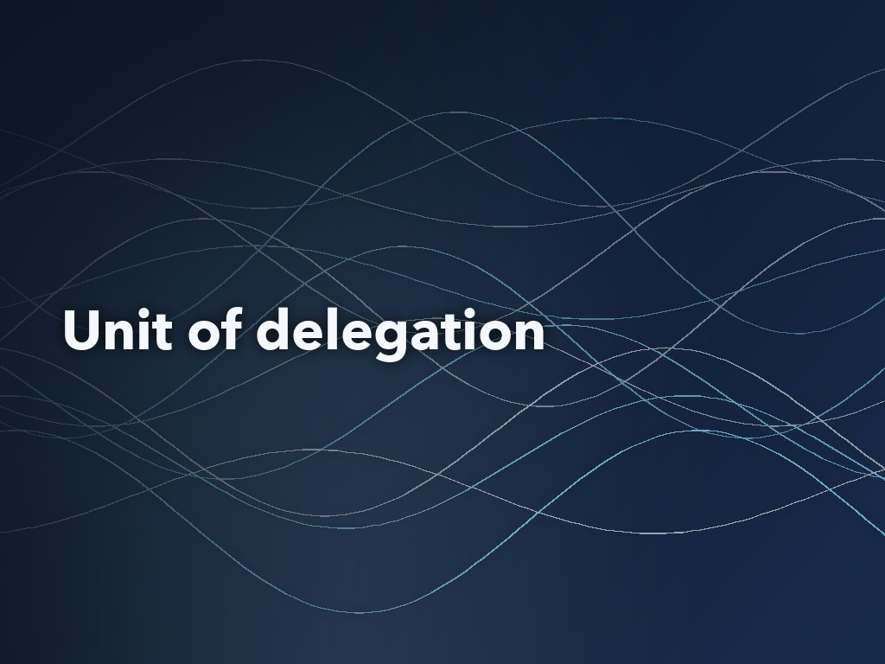
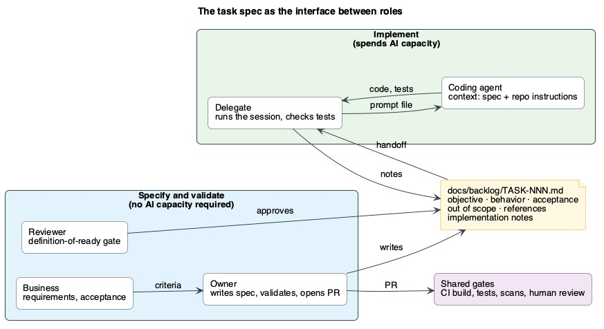
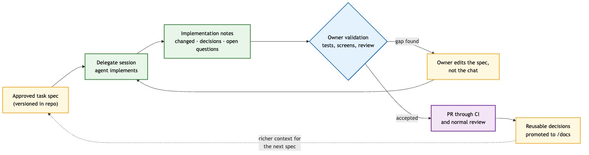

<!--
Meta description: Spec-driven development as a team pattern: versioned task specs let developers without spare AI capacity delegate implementation to colleagues who have it.
Tags: spec-driven development, GitHub Copilot, Spec Kit, AI-assisted development, code review, engineering management
-->



# Specs as the Unit of Delegation: Spec-Driven Development for Teams

**Key Takeaways**

- Spec-driven development is usually presented as a way for one developer to get better output from one coding agent; written down as a versioned task file, the same spec can also hand work from one person to another, with an agent doing the implementation.
- When AI coding capacity is capped per user and some developers hit their limit early while others finish the period with capacity unused or have no license at all, routing well-specified work to the people who still have capacity uses what the organization already pays for.
- Splitting the work into "specify and validate" and "implement" puts AI spend on the step where agents help most, and keeps accountability for intent and acceptance with the developer who owns the change.
- The pattern adds a second review point, a definition-of-ready check on the spec before any capacity is spent, which moves design feedback to the point where changes are cheapest.
- The pattern has risks: owners who stop implementing may lose debugging skill, delegates can become a queue, reviewers face more Markdown, and the license and audit questions have to be answered before a team adopts it.

---

*By Wallace Espindola, Solution Architect · [wallace.espindola@gmail.com](mailto:wallace.espindola@gmail.com) · [LinkedIn](https://www.linkedin.com/in/wallaceespindola/) · [GitHub](https://github.com/wallaceespindola/)*

*Companion repository with the process definition, task template, Copilot instructions and prompt file discussed here: [github.com/wallaceespindola/share-tokens-using-spec-driven-dev](https://github.com/wallaceespindola/share-tokens-using-spec-driven-dev)*

---

## Most writing on specs and agents stops at one developer

Practices for working with coding agents have settled into a recognizable shape: write the intent down first, keep conventions in files the agent loads automatically, and package repeatable procedures. Spec-driven development, context engineering, `AGENTS.md`, custom instructions and agent skills all belong to this family.

Most of the published guidance on these practices, including the Spec Kit walkthrough, assumes one developer with one agent. The developer writes the spec, the agent implements it, and the same developer reviews the result. The spec is treated as a better prompt.

This article looks at a different use of the same artifacts. Once a spec is a versioned file that is complete enough for an agent to act on, it is also complete enough for a colleague to act on. That makes it a unit of delegation between people, with the agent doing the implementation. The motivating case is mundane: AI coding capacity is licensed per seat, often capped per user, and used unevenly. The organizational questions it raises are harder. Who owns a change that one person specified, a second person ran and an agent wrote? What does code review look like when the most important review happens before any code exists? What happens to the skills of developers who mostly specify and validate?

The analysis is grounded in a small reference process published as an open repository: a product requirements document (PRD), a task template, a filled-in example task (`TASK-042`, an order summary report job), repository-wide Copilot instructions and a shared prompt file. The process is a proposal and has not been measured in production, so this article discusses its design and trade-offs. It doesn't report outcomes.

## Where spec-driven development and context engineering came from

The vocabulary is recent, so it helps to pin down what each piece is and where it comes from.

### Spec-driven development

In September 2025, GitHub published Spec Kit, an MIT-licensed toolkit, and an accompanying blog post by Den Delimarsky. The post argues that coding agents "excel at pattern recognition but still need unambiguous instructions", and that "the issue isn't the coding agent's coding ability, but our approach." It describes four phases: specify the goal and the users, plan the stack and constraints, break the work into small testable tasks, and implement while the developer reviews focused changes. Its `specify` CLI sets a project up for a given agent (`specify init <project> --integration copilot` for GitHub Copilot) and installs a set of agent commands. `/speckit-constitution` runs once per project to record the principles the agent must follow. Each feature then goes through `/speckit-specify`, `/speckit-plan`, `/speckit-tasks`, `/speckit-implement` and `/speckit-converge`, and the README tells users to "repeat implement → converge until convergence reports Converged," reviewing each result before continuing.

Birgitta Böckeler's October 2025 analysis on martinfowler.com is useful because it separates three levels that often get blurred. In *spec-first*, "a well thought-out spec is written first, and then used in the AI-assisted development workflow for the task at hand." In *spec-anchored*, "the spec is kept even after the task is complete, to continue using it for evolution and maintenance of the respective feature." In *spec-as-source*, "the spec is the main source file over time" and the human never edits code. The delegation pattern in this article is spec-first with a lightweight anchor: task files stay in the repository after completion, and reusable decisions move into longer-lived design documents.

### Context engineering

Anthropic's engineering team defines it as "the set of strategies for curating and maintaining the optimal set of tokens (information) during LLM inference," and adds that context "must be treated as a finite resource with diminishing marginal returns." That framing matters here, because a delegated session should start with exactly the context the task needs, and nothing left over from earlier conversations.

### Repository instructions and `AGENTS.md`

GitHub Copilot reads repository-wide instructions from `.github/copilot-instructions.md`, path-specific rules from `.github/instructions/*.instructions.md` files scoped with an `applyTo` glob, and agent instructions from `AGENTS.md` files anywhere in the repository, where the nearest one in the directory tree takes precedence. The `AGENTS.md` project calls the format "a simple, open format for guiding coding agents."

### Prompt files and agent skills

VS Code supports prompt files, Markdown files with a `.prompt.md` extension in `.github/prompts`, which act as reusable slash commands and can select an agent mode and model in their frontmatter. The Agent Skills format packages a procedure as a folder with a `SKILL.md` file that agents load on demand. It started at Anthropic and is now an open standard that GitHub Copilot, VS Code and other clients support.

All of these artifacts make a repository easier for an agent to work in. None of them says who writes the spec, who runs the agent or who answers for the result. Teams have to settle that themselves.

## AI capacity is a constrained team resource

GitHub moved all Copilot plans to usage-based billing on June 1, 2026. Premium requests, the earlier unit, now apply only to legacy annual Pro and Pro+ plans. Each plan includes a monthly allotment of GitHub AI Credits, and usage is "calculated based on token consumption, including input, output, and cached tokens," so a long agent session on an expensive model costs more than a short one on a cheap model. For Copilot Business and Enterprise, the documentation states that a user's included credits "are pooled at the billing entity level," that "included AI credits do not carry over between months," and that administrators can set user-level budgets that "cap how much an individual user can consume per billing cycle." A user who exhausts that budget has Copilot halted even while the organization's pool still has credits, with "no automatic fallback to lower-cost models."

Pooling means unused capacity is no longer locked to one seat, but per-user budgets, which organizations can set for predictable spend, recreate per-person limits, and developers without a license have no access at all. The pattern targets that shape: each developer can spend up to a fixed amount per billing period, and nobody can spend on someone else's behalf except by doing the work.

Usage under that shape is uneven. Developers on agent-heavy tasks hit their limit early, others end the period well under it, and some have no license because of budget or procurement timing. The process rules out sharing accounts or licenses as a workaround.

Included credits left unused at the end of a month are forfeited, so they are money the organization has already spent. Routing work to the developers who still have capacity gets more out of the same contract without buying more seats.

The informal version already happens as a chat message: "can you run this through Copilot for me?" The request carries partial context, the delegate spends credits on clarifying questions, and the decisions disappear with the conversation. The reference process replaces that message with a file.

## The spec as an interface between roles

The PRD defines four roles. Business (a product owner or analyst) supplies requirements and acceptance criteria. The owner is the developer responsible for the change, often the one without capacity. A reviewer, typically an architect or tech lead, approves the task before anyone spends capacity on it. The delegate is a developer with enough Copilot capacity who runs the implementation session.



*Figure 1: The task file is the only thing that crosses from the people who specify and validate to the people who implement. Blue: roles that need no AI capacity. Green: roles that spend it. Amber: the versioned task spec. Purple: the gates every change passes, delegated or not.*

The task file plays the role an API contract plays between services. It has a fixed structure: objective, tech stack, inputs, numbered expected behavior, architecture constraints with links to the architecture, coding and testing guides, checkable acceptance criteria, an explicit out-of-scope list, references and an "Implementation notes" section the delegate fills in at handback. An abridged view of the example task:

```markdown
# TASK-042: Generate order summary report

## Expected behavior
1. Load the report configuration.
2. Retrieve the eligible orders.
3. Generate the report.
4. Store the delivery metadata.

## Acceptance criteria
- [ ] The job can be restarted after a failure.
- [ ] A failed run is recorded.

## Out of scope
- File transport
- Customer notification

## Implementation notes
- Changed:
- Decisions:
- Open questions:
```

Two repository files make the contract executable. The Copilot instructions file tells the agent that "the task file in `docs/backlog/TASK-NNN-*.md` is the only source of requirements," that it must respect the out-of-scope list, that every acceptance criterion maps to at least one test, and that "if the task is ambiguous, stop and list the questions instead of guessing." The shared `implement-task` prompt file runs in agent mode and walks the delegate through a fixed sequence: read the task and every referenced document, check the definition of ready, propose a plan and wait for confirmation, implement with tests, run the full suite, fill in the implementation notes and summarize the result in five lines or fewer.

The definition of ready is where the interface gets enforced. A reviewer approves a task only when the objective fits in one or two sentences, each behavior is a concrete step, each acceptance criterion can be checked by a test or visible result, the out-of-scope list exists, referenced documents are current, examples are included where format matters, the file contains no secrets or production data, and the task is small enough to produce a pull request one person can review in under an hour. Teams would tune that threshold. The more important property is that the check happens before any capacity is spent.

## Spec Kit's workflow, split across people

Spec Kit's sequence is written as if one person runs every command. Nothing in it requires that. Each step produces or consumes a Markdown artifact in the repository, so different people can own different steps as long as the artifacts are good enough to hand over. The reference process does this with lighter artifacts than a full Spec Kit run:

| Spec Kit step | Artifact in the reference process | Who owns it | Spends AI capacity? |
|---|---|---|---|
| Constitution, once per project | Team standards in `/docs` (architecture, coding and testing guides) and `.github/copilot-instructions.md` | Architects and tech leads | No |
| Specify | Business requirements, written up by the owner in `/docs/specs` | Business and owner | No |
| Plan and tasks | One approved `TASK-NNN.md` file per deliverable, checked against the definition of ready | Owner writes, reviewer approves | No |
| Implement | The delegate's Copilot session, driven by the shared prompt file | Delegate and agent | Yes |
| Converge | Owner validation; gaps go back into the task file for another iteration | Owner | No |

In single-developer spec-driven development, these steps structure one person's conversation with an agent. Split across roles, they become a division of labor in which only one step consumes metered capacity. Converge changes the most. In Spec Kit it is an agent command run by the same developer who ran implement. In the delegated version it becomes an acceptance decision by the person who wrote the spec and will answer for the change. A team can still run an agent-driven convergence check before handing back, at the cost of more credits.

## Separating specifying and validating from implementing

The economic argument for the split is simple. Writing a precise spec and validating the result consume no AI credits. Implementation is where an agent saves the most time per credit spent. So the owner does the thinking and the checking, and the delegate spends capacity only on the step that benefits from it.

The split also forces intent into a durable form. When one developer specifies, implements and reviews, gaps in the spec get filled silently from memory. When the implementer is someone else working through an agent, every gap shows up, either as a clarifying question, as a "stop and list the questions" response from the agent, or as a mismatch during validation. The process tells the owner to fix that gap in the task file rather than in a chat, so the correction becomes part of the record.



*Figure 2: The feedback loop. Amber: artifacts in the repository. Green: the delegate's session and its output. Blue: the owner's validation decision. Purple: the normal merge path. The dashed edge is the slow loop, through which project documentation improves over time.*

Validation stays with the owner, and it goes beyond reading the diff: unit and integration tests, functional or simulation tests, and the affected screens. Small issues the owner fixes directly. Larger ones go back to the delegate through an updated task file. The PRD suggests tracking iterations per task and treats more than two as a signal that the task was not ready, which is a useful leading indicator for spec quality.

## Consequences for review, ownership, onboarding and knowledge

### Code review gets an earlier checkpoint

The definition-of-ready review is a design review with a strict scope, held at the point where changes are cheapest. A reviewer who checks that "the job can be restarted after a failure" is testable and that file transport is clearly out of scope is doing work that would otherwise surface as comments on a finished pull request. The code review after implementation doesn't go away, and the process requires that delegated work pass the same CI, security scans, quality gates and human review as any other change. GitHub's documentation for the cloud agent makes a similar point about its own session logs, which "do not replace your own review and testing."

### Ownership becomes explicit

The owner writes the spec, validates the result, makes the final commit and opens the pull request. The delegate is accountable for running the session faithfully and reporting what changed and why. The relationship resembles a feature owner working with a contractor. The weak point is attribution. A pull request opened by the owner doesn't say who ran the session. The task file records the delegate by name and the implementation notes record the decisions, which keeps the information available. Teams that need stronger provenance will want something machine-readable on top, such as an issue label and a link from the pull request to the task.

### Onboarding gets worked examples

Completed task files, with their acceptance criteria and implementation notes, show how the team decomposes work and what "done" means locally. A newcomer acting as an owner learns to specify against real constraints and gets concrete reviewer feedback. Whether that builds the same depth as implementing is discussed below.

### Knowledge moves from chats to the repository

This was the original goal of the process: "Everything needed to understand a task is in `/docs`. None of it exists only in a Copilot conversation." Over time, decisions that recur get promoted from implementation notes into design documents such as the report-generation design that `TASK-042` references, which in turn give the next spec better context. That moves the team gradually toward Böckeler's spec-anchored level without committing to spec-as-source.

## Risks and open questions

### Deskilling

A randomized controlled trial published by Anthropic in January 2026 had 52 mostly junior engineers learn an unfamiliar Python library with or without AI assistance. The AI group averaged 50% on a follow-up quiz against 67% for the group that coded by hand, the largest gap was on debugging questions, and participants who wholly delegated code generation were among the low scorers. The study covered one learning session, a narrower question than long-term skill, but it applies. An owner who only specifies and validates keeps reading and checking code and gets less practice at debugging, the area where the study found the largest gap. Teams adopting the pattern should rotate roles, keep some implementation with every developer, and treat validation as hands-on work that includes running and breaking the code.

### The delegate bottleneck

Delegates spend their own budget and their own time on other people's work. If capacity is concentrated in a few developers, they become a queue, and their own tasks slip. The PRD's mitigations are modest: delegates publish available capacity on an issue board, and a growing queue is treated as a signal that the team needs more capacity or smaller tasks. Teams also need management to agree explicitly that delegate time counts as work, or the pattern will run on goodwill.

### Review load and Markdown volume

Böckeler's reaction to Spec Kit's output applies here too: "to be honest, I'd rather review code than all these markdown files," and for a small feature the workflow "was like using a sledgehammer to crack a nut." The task template here is deliberately small compared to a full Spec Kit run, but it still adds an artifact to write and review for every delegated change. The PRD's response is to delegate only work where implementation is large relative to the overhead, and to keep one-line fixes, configuration changes and exploratory work with the owner.

### Agents that ignore instructions

Böckeler also reports that she "frequently saw the agent ultimately not follow all the instructions." The process mitigates this with an explicit stop-and-ask rule, a plan step before edits, a full test run before handback and owner validation afterwards. None of these guarantees compliance. They make non-compliance visible earlier.

### Policy, licensing and compliance

The process states that nothing in it grants anyone access they did not already have, that task files never contain secrets, credentials or production data, and that Copilot is used only within the organization's approved settings, such as public code filtering and content exclusions. Two questions aren't settled by the process itself. The first is contractual: whether a licensed user running sessions on behalf of an unlicensed colleague is acceptable under the organization's agreement. Teams should confirm that with their own procurement and vendor terms before adopting the pattern. The second is about audit: in regulated environments, the record of who produced a change may need to be stronger than a name in a Markdown file.

### Measurement

The PRD proposes a few per-sprint numbers: tasks delegated and merged, iterations per task, time from approval to merge compared with similar tasks done by hand, and tasks waiting for a delegate. They are cheap to collect from issues and pull requests, and until a team collects them, any claim that the pattern saves time is a hypothesis.

## When the pattern does not fit


*Figure 3: A rough fit test. Amber: questions. Grey: outcomes where delegation is the wrong choice. Green: the case the pattern targets.*

If capacity is evenly distributed, every developer can run their own spec-driven loop and a handoff only adds latency. Exploratory work where the design is still open should stay with the owner, because a spec written too early locks in guesses that a delegate cannot resolve. Small changes cost more to write up, review and validate than to implement. Incidents need someone on call now. Some code is off limits to the delegate's tools, because of content exclusions, data classification or contract terms. The pattern also requires a team that already writes testable acceptance criteria. Delegation exposes weak specs quickly, and a team without that habit will see iterations per task rise before it sees any benefit.

It fits best where the work is well understood and mechanical relative to its size: new endpoints, services or jobs with a clear design, test suites for existing code, refactors and migrations across many files, boilerplate such as DTOs, mappers and repositories, and documentation generated from code.

## Conclusion

The artifacts of spec-driven development, a versioned spec, repository instructions, a shared prompt and a definition of ready, are also an interface between people. When AI capacity is capped per user and used unevenly, that interface lets a team route implementation to where capacity exists, while the developer who owns the change keeps responsibility for intent and acceptance.

The pattern has costs. It adds a review step, a file per task and a coordination role, and it may erode the debugging skills of developers who mostly specify. It also imposes a discipline that pays off even where capacity is plentiful: each change has its intent written down, reviewed before implementation and kept in the repository after the conversation ends. A team can try it at low risk with a handful of tasks and the measurements the process already defines.

## References

- GitHub, [Spec Kit repository](https://github.com/github/spec-kit)
- Den Delimarsky, [Spec-driven development with AI: Get started with a new open source toolkit](https://github.blog/ai-and-ml/generative-ai/spec-driven-development-with-ai-get-started-with-a-new-open-source-toolkit/), GitHub Blog, September 2025
- Birgitta Böckeler, [Understanding Spec-Driven-Development: Kiro, spec-kit, and Tessl](https://martinfowler.com/articles/exploring-gen-ai/sdd-3-tools.html), martinfowler.com, October 2025
- Anthropic, [Effective context engineering for AI agents](https://www.anthropic.com/engineering/effective-context-engineering-for-ai-agents), September 2025
- Anthropic, [How AI assistance impacts the formation of coding skills](https://www.anthropic.com/research/AI-assistance-coding-skills), January 2026
- GitHub Docs, [Adding repository custom instructions for GitHub Copilot](https://docs.github.com/en/copilot/how-tos/configure-custom-instructions/add-repository-instructions)
- GitHub Changelog, [GitHub Copilot is moving to usage-based billing](https://github.blog/changelog/2026/04/27/github-copilot-is-moving-to-usage-based-billing/), April 2026
- GitHub Docs, [Usage-based billing for organizations and enterprises](https://docs.github.com/en/copilot/concepts/billing/usage-based-billing-for-organizations-and-enterprises)
- GitHub Docs, [About Copilot cloud agent](https://docs.github.com/en/copilot/concepts/agents/coding-agent/about-coding-agent)
- VS Code Docs, [Prompt files](https://code.visualstudio.com/docs/copilot/customization/prompt-files)
- [AGENTS.md](https://agents.md/)
- [Agent Skills](https://agentskills.io/)
- Companion repository with the PRD, task template, example task, Copilot instructions and prompt file: [github.com/wallaceespindola/share-tokens-using-spec-driven-dev](https://github.com/wallaceespindola/share-tokens-using-spec-driven-dev)

**Examples repository:** every example in this article (the PRD, the TASK-042 task spec, the team guides, the Copilot instructions, the prompt file and the diagrams) is in <https://github.com/wallaceespindola/share-tokens-using-spec-driven-dev>.

## About the author

**Wallace Espindola, Solution Architect**

Wallace Espindola is a senior software engineer and solution architect working across Java/Spring Boot and Python/FastAPI backends, cloud-native microservices on Kubernetes and OpenShift, and system architecture design. He maintains the open-source repository behind this article, which defines a spec-driven process for delegating implementation work between developers with and without spare AI coding capacity.

Contact: [wallace.espindola@gmail.com](mailto:wallace.espindola@gmail.com) · [LinkedIn](https://www.linkedin.com/in/wallaceespindola/) · [GitHub](https://github.com/wallaceespindola/)

---

**AI disclosure**: This article was drafted with AI assistance (Claude) for research support, outlining, drafting and editing, based on the author's own process definition and repository. Quotes and product details were checked against the cited sources.

**Publishing note**: This article is submitted for InfoQ's 4-week exclusive publishing window. It will not be cross-posted to other platforms until that window closes.
