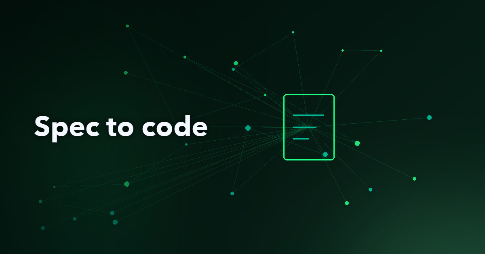
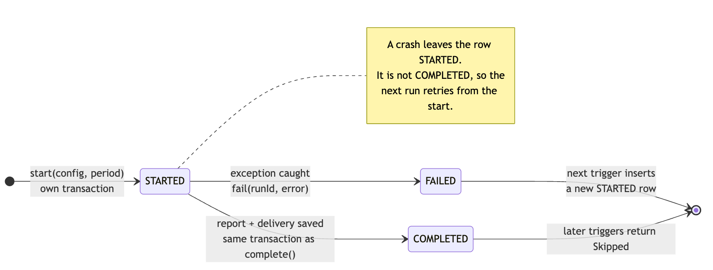

# From TASK-042 to tested Java: delegating a Spring Boot job

**By Wallace Espindola, Solution Architect**
<wallace.espindola@gmail.com> | [LinkedIn](https://www.linkedin.com/in/wallaceespindola/) | [GitHub](https://github.com/wallaceespindola/)

*I wrote this article with AI assistance, then reviewed, fact-checked and edited it myself.*

---

## Abstract

On many Java teams, GitHub Copilot capacity is uneven: some developers have no license, some run out of credits early, others end the billing period with credits nobody used. One way to rebalance that without sharing accounts is spec-driven development in the style of GitHub Spec Kit, with the work split between two people. The owner writes a version-controlled task spec and validates the result; a delegate who still has credits implements it with Copilot. This article follows one such spec, `TASK-042: Generate order summary report`, to a restartable Java 25 and Spring Boot job on PostgreSQL, without Spring Batch. It shows how the spec becomes types and transaction boundaries, how each acceptance criterion maps to a JUnit 5 test, and what the owner checks before the pull request.

---

## Introduction

Most companies buy Copilot through a contract where each developer works against a personal limit per billing period: a per-user allowance of GitHub AI Credits, or a per-user budget on top of the organization's pool. One developer hits that limit early, another finishes the month with most of it untouched, a third has no license. Because a limit belongs to one user, the leftover credits help nobody else, though the company has already paid for them.

The informal workaround is a chat message: "Could you run this through Copilot for me?" The delegate's session then starts without the architecture context, credits go into clarifying questions, and the decisions disappear with the conversation.

The process in the [share-tokens-using-spec-driven-dev](https://github.com/wallaceespindola/share-tokens-using-spec-driven-dev) repository replaces that message with a Markdown file, `docs/backlog/TASK-NNN-short-slug.md`, reviewed before anyone spends a credit. The owner writes the spec, validates the implementation, makes the final commit and opens the PR. The delegate spends credits only on implementation.

This article is for the people who will read the diff. I take the repository's example task, TASK-042, and show what a reasonable implementation looks like in a Java 25 and Spring Boot 4 service on PostgreSQL. The repository holds the process (PRD, task template, guides, design note, Copilot instructions and prompt file), not a Spring Boot application, so every listing below is my illustration of what a delegate could hand back, not production code.

## Why a batch job is a good unit of delegation

The PRD recommends delegating new endpoints, services or jobs with a clear spec. A reporting job fits: well-defined inputs and outputs, several layers, and mostly mechanical code once the design is fixed. The design note `docs/specs/report-generation/design.md` already lists the tables (`report_configuration`, `orders`, `report_run`, `report_delivery`) and the restart rule: before generating, look in `report_run` for a completed run with the same configuration and period, skip if one exists, and otherwise retry from the start.

Spring Batch would also give you restartability, and for chunked processing with per-item skip and retry it is the right tool. TASK-042 produces one report per configuration and period, and the team's `ARCHITECTURE.md` already prescribes a simpler pattern: "A long-running job records each run (start, end, status, error) in a run table. A restarted job reads that table to skip work that already completed." Spring Batch would add a second notion of "run" next to `report_run`, so the spec points to plain Spring with JDBC.

## Where spec-driven development and Spec Kit fit

In spec-driven development the spec is the source of truth and the code is derived from it and checked against it. [GitHub Spec Kit](https://github.com/github/spec-kit) packages the idea for coding agents, including Copilot: install the CLI with `uv tool install specify-cli`, run `specify init <project> --integration copilot`, then use `/speckit-constitution` once per project and `/speckit-specify`, `/speckit-plan`, `/speckit-tasks`, `/speckit-implement` and `/speckit-converge` per feature. The delegation process maps onto those stages, split by who holds the credits:

| Spec Kit stage | In this process | Who | Copilot credits |
|----------------|-----------------|-----|-----------------|
| Constitution | `ARCHITECTURE.md`, `CODING_GUIDE.md`, `TESTING_GUIDE.md`, `copilot-instructions.md` | Team, once | None |
| Specify | Business requirements and `docs/specs/report-generation/design.md` | Business and owner | None |
| Plan and tasks | The approved `TASK-042-order-summary-report.md` | Owner, reviewer | None |
| Implement | The delegate's Copilot session with `/implement-task` | Delegate | Delegate's |
| Converge | Owner validation, fixes or another iteration | Owner | None, or owner's own |

For TASK-042, plan and tasks collapse into one reviewed file. The repository's `implement-task` prompt plays the role of `/speckit-implement`, with two extra rules: stop at the definition of ready, and fill in the implementation notes.

## Reading TASK-042 the way a compiler would

Here is the task's core, unchanged from the repository:

```markdown
## Expected behavior
1. Load the report configuration.
2. Retrieve the eligible orders.
3. Generate the report.
4. Store the delivery metadata.

## Acceptance criteria
- [ ] The report is generated for all eligible orders.
- [ ] The job can be restarted after a failure.
- [ ] A failed run is recorded.
- [ ] Unit tests cover the new code.
- [ ] Integration tests cover the end-to-end flow.

## Out of scope
- File transport
- Customer notification
```

For a code generator, this has holes. Step 2 of the shared prompt file tells Copilot to check the task against the definition of ready and, "if anything is missing or ambiguous, stop and list the questions for the owner." A careful session would plausibly ask (my example, not a transcript): what format is the report, where is the content stored if transport is out of scope, what makes an order eligible, what is a period and who triggers the job, and what happens if two instances run at once?

Each question costs one request; a wrong guess reworked across five files costs many. The owner answers in the task file, so the answers are reviewed and versioned:

```markdown
## Output
- CSV, UTF-8, header row: order_id,customer_ref,amount,placed_at
- One row per eligible order, ordered by order_id. Amount uses plain decimal notation.
- The CSV content is stored in report_delivery.content. Transport picks it up later.

## Eligibility
- report_configuration.eligible_statuses lists the order statuses to include.
- The period is a calendar month in UTC: placed_at >= first day, < first day of next month.

## Trigger
- Expose a callable job. Scheduling is TASK-043.

## Concurrency
- Two concurrent runs must never produce two completed reports for the same
  configuration and period. Enforce it in the database.
```

## The guardrails: instructions and the prompt file

GitHub adds `.github/copilot-instructions.md` to Copilot Chat requests in the repository automatically. The part that matters for TASK-042:

```markdown
## When implementing a task

- The task file in `docs/backlog/TASK-NNN-*.md` is the only source of requirements.
  Do not add behavior it does not ask for, and respect its "Out of scope" list.
- Follow `docs/ARCHITECTURE.md`, `docs/CODING_GUIDE.md` and `docs/TESTING_GUIDE.md`.
- Stack: Java 25, Spring Boot, PostgreSQL, Kafka only where the task requires it, JUnit 5 and Mockito.
- Every acceptance criterion maps to at least one test. Run the full test suite before handing back.
- Fill in the task's "Implementation notes" section: what changed, decisions made, open questions.
- If the task is ambiguous, stop and list the questions instead of guessing.
```

Each line rules out a familiar failure: the REST endpoint nobody asked for, a `KafkaTemplate` because the stack mentions Kafka, an SFTP client despite the out-of-scope list.

The prompt file `.github/prompts/implement-task.prompt.md` sets `agent: agent` in its frontmatter, so it runs in agent mode, and the delegate starts it with `/implement-task`. Its steps: read the task and every referenced document, check the definition of ready, propose a plan listing which test covers each acceptance criterion and wait for confirmation, implement, run the full suite, fill in the implementation notes, and summarize in five lines or fewer. The plan step is where someone can catch "AC2 is covered by a test that mocks the run table", which would prove nothing about restart.

## From spec sections to Java types

With the task amended, the mapping is close to mechanical:

| Spec section | Java and SQL |
|--------------|--------------|
| Inputs: configuration, eligibility | `ReportConfiguration`, `EligibleOrder` records; `OrderRepository.findEligible` filters in SQL |
| Expected behavior 3 and 4 | `OrderSummaryReportGenerator`, `ReportDeliveryRepository` |
| Restart, failure (design.md) | `report_run` table, `ReportRunRepository`, `RunOutcome` sealed interface |
| Concurrency | Partial unique index on `report_run` |


*Figure 1. Components of the illustrative TASK-042 implementation. The job orchestrates, the generator is pure, and each repository owns one table.*

The delegate adds one Flyway migration (the version number is a placeholder), assuming `report_configuration` with an `eligible_statuses TEXT[]` column and `orders` already exist:

```sql
-- V12__report_run_and_delivery.sql
CREATE TABLE report_run (
    id               UUID        PRIMARY KEY,
    configuration_id BIGINT      NOT NULL REFERENCES report_configuration (id),
    period_start     DATE        NOT NULL,
    period_end       DATE        NOT NULL,
    status           VARCHAR(16) NOT NULL
                     CHECK (status IN ('STARTED', 'COMPLETED', 'FAILED')),
    started_at       TIMESTAMPTZ NOT NULL,
    finished_at      TIMESTAMPTZ,
    error            TEXT
);

-- At most one completed run per configuration and period, whatever the application does.
CREATE UNIQUE INDEX report_run_completed_once
    ON report_run (configuration_id, period_start, period_end)
    WHERE status = 'COMPLETED';

```

A `report_delivery` table keyed by `run_id` holds the file name, order count, total and CSV content. The partial unique index answers the concurrency question in the database: any number of `FAILED` rows per period, at most one `COMPLETED`. A second instance that tries to complete the same period fails on the index, and its transaction rolls back.

Records carry the data, with validation in compact constructors (each record in its own file in the real code):

```java
/** A calendar month in UTC: start inclusive, end exclusive. */
public record ReportPeriod(LocalDate start, LocalDate endExclusive) {
    public ReportPeriod {
        if (!start.isBefore(endExclusive)) throw new IllegalArgumentException("empty period");
    }

    public static ReportPeriod of(YearMonth month) {
        return new ReportPeriod(month.atDay(1), month.plusMonths(1).atDay(1));
    }
}

public record ReportConfiguration(long id, String name, List<String> eligibleStatuses) {
    public ReportConfiguration {
        eligibleStatuses = List.copyOf(eligibleStatuses);
        if (eligibleStatuses.isEmpty()) throw new IllegalArgumentException("no eligible statuses");
    }
}

public record EligibleOrder(long orderId, String customerRef, BigDecimal amount, Instant placedAt) {}

public record OrderSummaryReport(String fileName, int orderCount, BigDecimal totalAmount, String content) {}

public sealed interface RunOutcome {
    record Skipped(UUID completedRunId) implements RunOutcome {}
    record Completed(UUID runId, int orderCount) implements RunOutcome {}
    record Failed(UUID runId, String error) implements RunOutcome {}
}
```

`OrderSummaryReport` holds the CSV as a `String` because a record's generated `equals` compares arrays by reference. The sealed `RunOutcome` means that when TASK-043 adds scheduling, a `switch` over the outcome needs no `default` branch, and a fourth outcome added later breaks compilation wherever it is not handled.

## Repositories with JdbcClient

The job runs a handful of hand-written statements. `JdbcClient`, added in Spring Framework 6.1 and auto-configured by Spring Boot, fits: named parameters, text blocks and lambda row mappers. The run table repository holds the restart logic (imports omitted):

```java
@Repository
public class ReportRunRepository {

    private final JdbcClient jdbc; // constructor injection omitted
    private final Clock clock;

    public Optional<UUID> findCompleted(long configurationId, ReportPeriod period) {
        return jdbc.sql("""
                SELECT id FROM report_run
                WHERE configuration_id = :configurationId
                  AND period_start = :start AND period_end = :end AND status = 'COMPLETED'
                """)
            .param("configurationId", configurationId)
            .param("start", period.start())
            .param("end", period.endExclusive())
            .query((rs, rowNum) -> rs.getObject("id", UUID.class))
            .optional();
    }

    public UUID start(long configurationId, ReportPeriod period) {
        UUID id = UUID.randomUUID();
        jdbc.sql("""
                INSERT INTO report_run (id, configuration_id, period_start, period_end, status, started_at)
                VALUES (:id, :configurationId, :start, :end, 'STARTED', :now)
                """)
            .param("id", id)
            .param("configurationId", configurationId)
            .param("start", period.start())
            .param("end", period.endExclusive())
            .param("now", now())
            .update();
        return id;
    }

    public void complete(UUID runId) {
        finish(runId, "COMPLETED", null);
    }

    public void fail(UUID runId, String error) {
        finish(runId, "FAILED", error);
    }

    private void finish(UUID runId, String status, String error) {
        int updated = jdbc.sql("""
                UPDATE report_run SET status = :status, finished_at = :now, error = :error
                WHERE id = :id AND status = 'STARTED'
                """)
            .param("status", status)
            .param("now", now())
            .param("error", error, Types.VARCHAR)
            .param("id", runId)
            .update();
        if (updated != 1) {
            throw new IllegalStateException("Run " + runId + " is not in STARTED state");
        }
    }

    private OffsetDateTime now() {
        // The PostgreSQL driver maps OffsetDateTime to timestamptz; Instant is not a standard JDBC type.
        return OffsetDateTime.ofInstant(clock.instant(), ZoneOffset.UTC);
    }
}
```

The `status = 'STARTED'` guard makes each transition happen once: calling `complete` twice, or `fail` after `complete`, throws instead of rewriting history. The injected `Clock` keeps `Instant.now()` out of the code. `OrderRepository.findEligible` follows the coding guide and filters in SQL: `status IN (:statuses) AND placed_at >= :from AND placed_at < :to ORDER BY id`, with Spring expanding the status list into the `IN` clause and the period bounds passed as UTC `OffsetDateTime` values.

The other repositories follow the same shape. The generator is a pure function that writes the header, one CSV line per order using `amount().toPlainString()`, and the total. It does no CSV escaping because the amended spec defines `customer_ref` as an opaque reference; if free text ever appears in the output, the spec has to say so.

## The job and its transaction boundaries

The job is where the design note's flow becomes code (imports, fields and constructor omitted):

```java
@Service
public class OrderSummaryReportJob {

    // Logger and final fields for runs, configurations, orders, generator,
    // deliveries and transactions (TransactionOperations) omitted.

    public RunOutcome run(long configurationId, ReportPeriod period) {
        Optional<UUID> completed = runs.findCompleted(configurationId, period);
        if (completed.isPresent()) {
            return new RunOutcome.Skipped(completed.get());
        }

        // Committed on its own, so the row survives a rollback of the work below.
        UUID runId = runs.start(configurationId, period);
        try {
            Integer orderCount = transactions.execute(status -> {
                ReportConfiguration config = configurations.findById(configurationId)
                    .orElseThrow(() -> new IllegalStateException(
                        "No report configuration with id " + configurationId));
                List<EligibleOrder> eligible = orders.findEligible(config, period);
                OrderSummaryReport report = generator.generate(config, period, eligible);
                deliveries.save(runId, report);
                runs.complete(runId);
                return report.orderCount();
            });
            return new RunOutcome.Completed(runId, orderCount);
        } catch (RuntimeException e) {
            String error = e.getClass().getSimpleName() + ": " + e.getMessage();
            runs.fail(runId, error);
            log.error("Order summary run {} failed for configuration {} and {}",
                      runId, configurationId, period, e);
            return new RunOutcome.Failed(runId, error);
        }
    }
}
```

The transaction design is the part an owner should read twice:

- The `STARTED` row commits on its own: `run` isn't `@Transactional`, so `start` auto-commits. If the work rolls back, the row is still there to be marked `FAILED`. Annotating `run` would roll back the `STARTED` insert too, and a failed run would leave no trace, breaking acceptance criterion 3.
- The delivery and the `COMPLETED` update share one transaction, so a crash between them can't produce a delivery without a completed run, or the reverse.
- `TransactionOperations` instead of a `@Transactional` helper: a `@Transactional` method called from the same class bypasses the Spring proxy. `TransactionOperations` is the interface `TransactionTemplate` implements, Spring Boot auto-configures the template, and the unit test can pass `TransactionOperations.withoutTransaction()`.
- One log line per failure: the job records the error, logs it with the run ID and returns `Failed` without rethrowing, as the coding guide asks.

## Restart and failure, step by step

Figure 2 shows three triggers for the same configuration and month: the first fails while saving the delivery, the second retries and completes, the third is skipped.


*Figure 2. Restart after failure. Only a `COMPLETED` row stops a new run; `FAILED` and `STARTED` rows do not.*



*Figure 3. Lifecycle of one `report_run` row. Each transition is a test case.*

A run that dies hard (pod killed, connection lost during `fail`) leaves a `STARTED` row, which the restart rule treats like a failure. If two instances race, only one can reach `COMPLETED` because of the partial index; the other rolls back, including its delivery, and records `FAILED`.

## Mapping acceptance criteria to tests

The testing guide requires at least one test per acceptance criterion, with JUnit 5 and Mockito for units and a real PostgreSQL for integration. The prompt file asks for this mapping in the plan:

| Acceptance criterion | Unit test (JUnit 5, Mockito) | Integration test (Testcontainers PostgreSQL) |
|----------------------|------------------------------|-----------------------------------------------|
| AC1: report generated for all eligible orders | `OrderSummaryReportGeneratorTest.includesEveryEligibleOrder` | `OrderSummaryReportJobIT.generatesReportForEligibleOrdersOnly` |
| AC2: job can be restarted after a failure | `OrderSummaryReportJobTest.skipsWhenCompletedRunExists` | `OrderSummaryReportJobIT.restartAfterFailureCompletesOnce` |
| AC3: a failed run is recorded | `OrderSummaryReportJobTest.recordsFailedRunWithError` | `OrderSummaryReportJobIT.restartAfterFailureCompletesOnce` |
| AC4: unit tests cover the new code | All of the above, plus the coverage report | |
| AC5: integration tests cover the end-to-end flow | | Both `IT` methods |

Naming tests after the criterion means a failing `restartAfterFailureCompletesOnce` in the PR tells everyone which requirement broke.

`OrderSummaryReportJobTest` defines `SEPTEMBER` and `CONFIG` constants, uses `@Mock` repositories and passes `TransactionOperations.withoutTransaction()` to the constructor, so the callback runs directly. The AC3 case:

```java
@Test // AC3
void recordsFailedRunWithError() {
    UUID runId = UUID.randomUUID();
    when(runs.findCompleted(7L, SEPTEMBER)).thenReturn(Optional.empty());
    when(runs.start(7L, SEPTEMBER)).thenReturn(runId);
    when(configurations.findById(7L)).thenReturn(Optional.of(CONFIG));
    when(orders.findEligible(CONFIG, SEPTEMBER))
        .thenThrow(new QueryTimeoutException("statement timeout"));

    assertThat(job.run(7L, SEPTEMBER)).isInstanceOf(RunOutcome.Failed.class);
    verify(runs).fail(eq(runId), contains("statement timeout"));
    verify(runs, never()).complete(any());
    verifyNoInteractions(deliveries);
}
```

`skipsWhenCompletedRunExists` has the same shape and verifies that `start` is never called. `MockitoExtension` uses strict stubs, so a stub the code never calls fails the test. The generator test for AC1 needs no mocks; it should compare the total with `isEqualByComparingTo("15.00")`, because `BigDecimal.equals` also compares scale.

Unit tests can't prove that the SQL filters the right orders, that the `STARTED` row survives a rollback, or that the partial index exists. With Spring Boot's `@ServiceConnection`, a Testcontainers PostgreSQL container needs no JDBC URL properties. In Testcontainers 2.x, the class lives in `org.testcontainers.postgresql`:

```java
@SpringBootTest
@Testcontainers
class OrderSummaryReportJobIT {

    @Container
    @ServiceConnection
    static PostgreSQLContainer postgres = new PostgreSQLContainer("postgres:17-alpine");

    private static final ReportPeriod SEPTEMBER = ReportPeriod.of(YearMonth.of(2026, 9));

    @Autowired OrderSummaryReportJob job;
    @Autowired JdbcClient jdbc;
    @MockitoSpyBean ReportDeliveryRepository deliveries;

    @BeforeEach
    void seed() {
        jdbc.sql("TRUNCATE report_delivery, report_run, orders, report_configuration").update();
        jdbc.sql("""
                INSERT INTO report_configuration (id, name, eligible_statuses)
                VALUES (7, 'monthly-paid', ARRAY['PAID', 'SHIPPED'])
                """).update();
        jdbc.sql("""
                INSERT INTO orders (id, customer_ref, status, amount, placed_at) VALUES
                  (1, 'C001', 'PAID',      10.50, '2026-09-01T08:00:00Z'),
                  (2, 'C002', 'SHIPPED',    4.50, '2026-09-30T23:59:59Z'),
                  (3, 'C003', 'CANCELLED', 99.00, '2026-09-15T12:00:00Z'),
                  (4, 'C004', 'PAID',      20.00, '2026-10-01T00:00:00Z')
                """).update();
    }

    @Test // AC2, AC3, AC5
    void restartAfterFailureCompletesOnce() {
        doThrow(new DataAccessResourceFailureException("simulated outage"))
            .doCallRealMethod()
            .when(deliveries).save(any(), any());

        assertThat(job.run(7L, SEPTEMBER)).isInstanceOf(RunOutcome.Failed.class);
        assertThat(job.run(7L, SEPTEMBER)).isInstanceOf(RunOutcome.Completed.class);
        assertThat(job.run(7L, SEPTEMBER)).isInstanceOf(RunOutcome.Skipped.class);

        assertThat(jdbc.sql("SELECT status, error FROM report_run")
                .query((rs, rowNum) -> rs.getString("status") + ":" + rs.getString("error"))
                .list())
            .containsExactlyInAnyOrder(
                "FAILED:DataAccessResourceFailureException: simulated outage",
                "COMPLETED:null");
        assertThat(jdbc.sql("SELECT count(*) FROM report_delivery").query(Long.class).single())
            .isEqualTo(1L);
    }
}
```

The synthetic seed data includes one order with the wrong status and one just outside the month, so `generatesReportForEligibleOrdersOnly`, which expects an order count of 2, fails on a missing `WHERE` clause or an off-by-one on the boundary. `@MockitoSpyBean` (Spring Framework's replacement for the deprecated `@SpyBean`) makes the first `save` throw and later calls go to the real method. One test then proves that the failed run is recorded with its error, that the `STARTED` row survived the rollback, that the retry completes, that a third trigger is skipped, and that the failed attempt left no delivery behind. Once a suite has several integration test classes, move the container into a shared `@TestConfiguration` or use `@ImportTestcontainers`, as the Spring Boot reference recommends, because a static container stops after its class while the cached context lives on.

## What the owner checks during validation

The owner didn't write this code, but the PRD makes them responsible for it. For TASK-042 I would check, in order:

1. Scope: read the file list first. A `KafkaTemplate`, a controller, a scheduler or anything under `transport` or `notification` goes back to the delegate.
2. Architecture: classes sit in `..service` and `..repository`; repositories hold no business rules. Reading `orders` directly is fine only because the design note lists it as this service's table.
3. Transaction boundaries: `run` isn't `@Transactional`, and `start` and `fail` run outside the work transaction. This is the easiest place for a plausible diff to break AC3.
4. SQL: filtering in SQL, bound parameters, and the partial unique index present in the migration.
5. Tests that can fail: break the code on purpose. Remove the `findCompleted` check and `skipsWhenCompletedRunExists` should fail. Add `@Transactional` to `run` and `restartAfterFailureCompletesOnce` should fail because the `FAILED` row disappears. [PIT](https://pitest.org/) does this systematically.
6. Full suite and coverage: run everything locally, not just the new classes, against the testing guide's 80% line coverage target for new code.
7. Implementation notes: read them before the code. For TASK-042 they should name the migration, the repositories, the job and the tests; record the decisions (no Spring Batch, `STARTED` committed outside the work transaction, concurrency via the partial index); and raise open questions such as a sweeper for stale `STARTED` rows and an upper bound on orders per period.

Small fixes the owner makes directly; behavior changes go back into the task file. The PRD treats more than two iterations as a sign the task was not ready. Once validated, the owner commits and opens a PR that links the task file, and the normal CI/CD gates apply.

## Follow-up tasks, not this diff

- Stuck `STARTED` rows: they don't block restarts but hide failures. A sweeper or an age alert closes the gap; the threshold is a business decision.
- Observability: `report_run` is already an audit log. Expose counts by status through Micrometer and alert on `FAILED` rows for the current period.
- Volume: `findEligible` loads a month into memory. `JdbcClient` can return a `Stream` (closed with try-with-resources, consumed inside the transaction). If chunking and per-item skips start to matter, reconsider Spring Batch in its own task.
- Duplicate work: racing instances both generate before one loses on the index. A `pg_try_advisory_xact_lock` inside the work transaction lets the second give up early.

## Conclusion

Delegating TASK-042 works because the Java design questions were answered before a credit was spent: restartability lives in a run table, eligibility is a SQL predicate, failures are recorded by a `STARTED` row committed on its own, and concurrency is bounded by a partial unique index.

The habits carry over even without the capacity-sharing angle:

- Write acceptance criteria that a JUnit test can fail.
- Put invariants in the database when you can.
- Model outcomes as sealed types with records, so the compiler checks code nobody has written yet.
- Treat the definition of ready as a code review of the spec.

Copy the task template from the [repository](https://github.com/wallaceespindola/share-tokens-using-spec-driven-dev), write your next job as a spec, and see how much of the design you can settle before anyone opens Copilot.

## References

- share-tokens-using-spec-driven-dev (PRD, TASK-042, guides, Copilot configuration), [GitHub](https://github.com/wallaceespindola/share-tokens-using-spec-driven-dev)
- GitHub Spec Kit, [GitHub](https://github.com/github/spec-kit)
- Adding repository custom instructions for GitHub Copilot, [docs.github.com](https://docs.github.com/en/copilot/how-tos/configure-custom-instructions/add-repository-instructions)
- Spring Framework reference: JDBC data access with `JdbcClient`, [docs.spring.io](https://docs.spring.io/spring-framework/reference/data-access/jdbc/core.html)
- Spring Framework reference: programmatic transaction management, [docs.spring.io](https://docs.spring.io/spring-framework/reference/data-access/transaction/programmatic.html)
- Spring Boot reference: Testcontainers and service connections, [docs.spring.io](https://docs.spring.io/spring-boot/reference/testing/testcontainers.html)
- PostgreSQL documentation: partial indexes, [postgresql.org](https://www.postgresql.org/docs/current/indexes-partial.html)
- Spring Batch reference: job repository and restartability, [docs.spring.io](https://docs.spring.io/spring-batch/reference/job.html)
- PIT mutation testing, [pitest.org](https://pitest.org/)

---

## Author bio

Wallace Espindola is a senior software engineer and solution architect working with Java/Spring Boot, Python/FastAPI and cloud-native microservices on Kubernetes and OpenShift. He designs and documents backend systems and the engineering processes around them, from architecture decisions to test strategy. Lately he has been looking at how teams can use AI coding assistants with the same discipline they apply to code review and CI.

Reach him on [LinkedIn](https://www.linkedin.com/in/wallaceespindola/) or check out his projects on [GitHub](https://github.com/wallaceespindola/).

---

**Examples repository:** every example in this article (the PRD, the TASK-042 task spec, the team guides, the Copilot instructions, the prompt file and the diagrams) is in <https://github.com/wallaceespindola/share-tokens-using-spec-driven-dev>.

Need more tech insights?
Check out my GitHub, LinkedIn, and Speaker Deck.
Happy coding!
