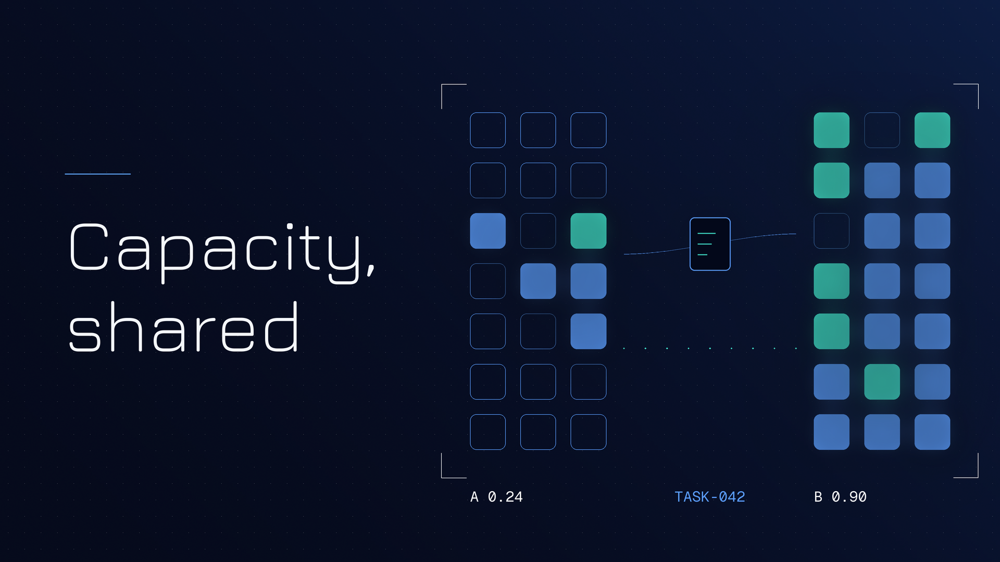
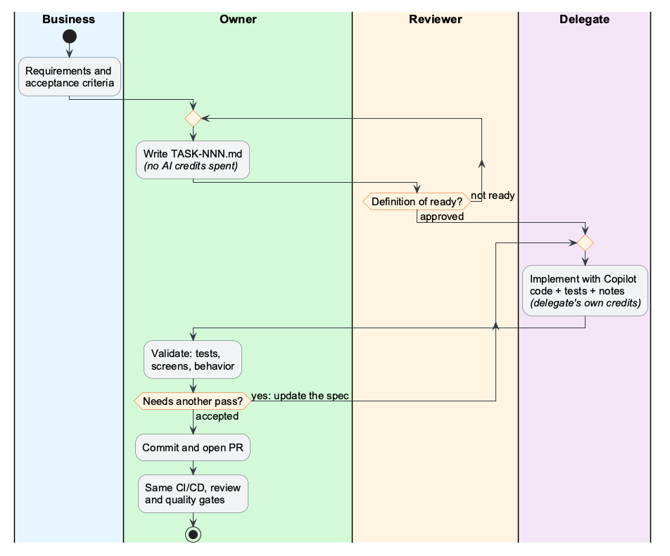

# Not everyone has Copilot. Share the work, not the seat



Most teams get GitHub Copilot through a company contract with Microsoft or GitHub, and each licensed developer works against a personal limit per billing period: a per-user credit allowance, or a per-user budget that admins set on the organization's pool. Usage is rarely even. Some developers hit their limit early. Others reach the end of the period with credits left over. And some colleagues have no license at all, so they write everything by hand while the person next to them has capacity sitting idle.

Those leftover credits are capacity the company has already paid for. As a tech lead or manager you can't ask for more seats every quarter, but you can route work to the people who still have credits. So I wrote down a process for doing that, without anyone sharing an account or bending the license terms. The proposal, a task template and a filled-in example live here: [share-tokens-using-spec-driven-dev on GitHub](https://github.com/wallaceespindola/share-tokens-using-spec-driven-dev).

## The problem leaders see

Copilot capacity is assigned per person. [GitHub's billing docs](https://docs.github.com/en/billing/concepts/product-billing/github-copilot-licenses) put it plainly: "A seat is a license for one user." Since June 2026, [every Copilot plan comes with a monthly allotment of GitHub AI Credits](https://github.blog/changelog/2026/04/27/github-copilot-is-moving-to-usage-based-billing/), and usage is charged against it. When each limit belongs to one user, the credits a colleague didn't use do nothing for the developer who ran out early, and nothing for the one without a seat.

The usual workarounds all have a cost:

- **Buy more seats:** the clean answer, when the budget exists. Often it doesn't, at least not this quarter.
- **Share a login:** off the table. [GitHub's terms](https://docs.github.com/en/site-policy/github-terms/github-terms-of-service) say a single login may not be shared by multiple people, and you lose any record of who wrote what.
- **Ask in chat:** "Can you run this through Copilot for me?" Half the context gets lost, the colleague spends credits on clarifying questions, and the result lives in a chat thread nobody can find a month later.

Check how your contract is set up before going further. GitHub's announcement also says that on Business and Enterprise plans, credits can be pooled across the organization, and admins can still set per-user budgets on top of that pool. Pooling with no per-user caps helps people who have a seat but run low, and makes the credit argument weaker. It does nothing for developers without a seat, though, and it doesn't decide which work the credits should go to.

## The principle: share the work, not the account

Writing a good spec costs no AI credits, and neither does validating the result. Implementation is where Copilot saves the most time. So split the work along that line.

The developer without capacity (the owner) does the thinking and the checking. A colleague with spare capacity (the delegate) runs the implementation with Copilot, using their own seat and their own credits. Nothing gets transferred except a Markdown file.

That file is a version-controlled task spec, `docs/backlog/TASK-NNN-short-slug.md`. The spec holds the objective, the expected behavior, acceptance criteria, what's out of scope and links to the architecture and testing guides. Both people and Copilot can read it, and it outlives any Copilot session.

This is spec-driven development applied at team level: the spec is written first, and the spec is what moves from owner to delegate. If you want tooling for it, [GitHub Spec Kit](https://github.com/github/spec-kit) is an optional, free and open-source toolkit that works with Copilot. After a one-time project constitution, it takes each feature through specify, plan, tasks, implement and converge.

## Four roles, one loop

| Role | Who | Responsible for |
|------|-----|-----------------|
| Business | Product owner or analyst | Requirements and acceptance criteria |
| Owner | Developer with no license or a small allowance | Writing the task, validating the result, final commit and PR |
| Reviewer | Architect, tech lead or senior developer | Approving the task before any credits are spent |
| Delegate | Developer with Copilot and enough credits | Implementing with Copilot, including tests and docs |



The reviewer step is what protects the delegate's credits. They get wasted when Copilot has to guess, so the reviewer approves a task only when it meets a short definition of ready: the objective fits in one or two sentences, each acceptance criterion can be checked by a test or a visible result, out of scope is listed, there are no secrets or production data in the file, and the work is small enough to review in under an hour.

Here's the shape of a ready task, trimmed from the example in the repo:

```markdown
# TASK-042: Generate order summary report
## Acceptance criteria
- [ ] The report is generated for all eligible orders.
- [ ] The job can be restarted after a failure.
- [ ] A failed run is recorded.
## Out of scope
- File transport
- Customer notification
```

## Ownership stays where it was

This is the part I'd want any engineering manager to check before agreeing to a pilot, because the owner stays accountable for the change. The owner validates the delegate's work with unit tests, functional tests and the affected screens. Small issues they fix themselves. For anything bigger they update the task file and ask for another pass, so the spec stays the source of truth instead of a chat thread. Then the owner makes the final commit and opens the pull request under their own name.

The delegate's name is recorded in the task, and they fill in an "Implementation notes" section at handback covering what changed, the decisions they made and anything left open.

## Same quality gates, no exceptions

Delegated work goes through exactly the same pipeline as everything else: build, tests, security scans, quality gates and human review. The PR merges only if all of them pass.

That also keeps security simple. Delegates already have access to the repository, so the process grants nobody new access. Copilot runs under whatever AI policy and settings your organization already enforces.

## What to measure

Four numbers per sprint tell you whether this pays off:

- **Tasks delegated and merged:** the basic throughput signal.
- **Iterations per task:** more than two usually means the task wasn't ready, which points at the spec or the reviewer gate, not the delegate.
- **Time from approval to merge:** compare it with similar tasks done by hand.
- **Tasks waiting for a delegate:** a growing queue means you need more capacity or smaller tasks. It's also evidence you can bring to the next budget conversation about seats.

Delegation has a fixed overhead (a spec, a review, a handoff, a validation), so it pays off on larger, well-defined work: new endpoints or jobs with a clear spec, test suites for existing code, mechanical refactors across many files, boilerplate. Keep one-line fixes, open-ended design work and live incidents with the owner.

## How to pilot it next sprint

1. **Set it up.** Copy the task template into `docs/backlog/`, create an `ai-delegation` issue label, and name one reviewer. Ask the developers with spare capacity to post on the board how many tasks they can take this sprint.
2. **Run two or three tasks through the loop.** Pick well-defined work, pair each owner with a delegate, and follow the steps as written. No shortcuts on the reviewer gate or the owner's validation, since those are what you're testing.
3. **Review the four numbers at the retro.** Talk through where specs needed rework and whether owners felt the validation step was real. Then decide whether to keep going, adjust the definition of ready, or stop.

## Summary

Uneven Copilot usage is a capacity-allocation problem, and it can be handled with process before it turns into a procurement problem. Routing work to the people with credits left gets more out of the contract you already pay for. Owners write the spec and keep accountability. Delegates spend their own credits where Copilot saves the most time. Reviewers make sure those credits aren't wasted, and every change goes through the same gates as before.

The full proposal, the task template and the TASK-042 example are here: [github.com/wallaceespindola/share-tokens-using-spec-driven-dev](https://github.com/wallaceespindola/share-tokens-using-spec-driven-dev).

How does your team handle uneven access to AI coding tools today: more seats, pooled credits, informal favors, or something else? Let me know your thoughts in the comments.

---

**Examples repository:** every example in this article (the PRD, the TASK-042 task spec, the team guides, the Copilot instructions, the prompt file and the diagrams) is in <https://github.com/wallaceespindola/share-tokens-using-spec-driven-dev>.

Need more tech insights?
Check out my GitHub, LinkedIn, and Speaker Deck.
Happy coding!

Wallace Espindola, Solution Architect

GitHub: <https://github.com/wallaceespindola/>
LinkedIn: <https://www.linkedin.com/in/wallaceespindola/>

**#githubcopilot #engineeringleadership #softwareengineering #ai #techleadership #specdrivendevelopment**
