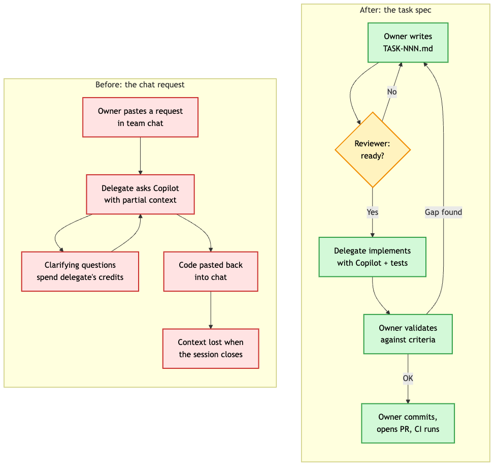
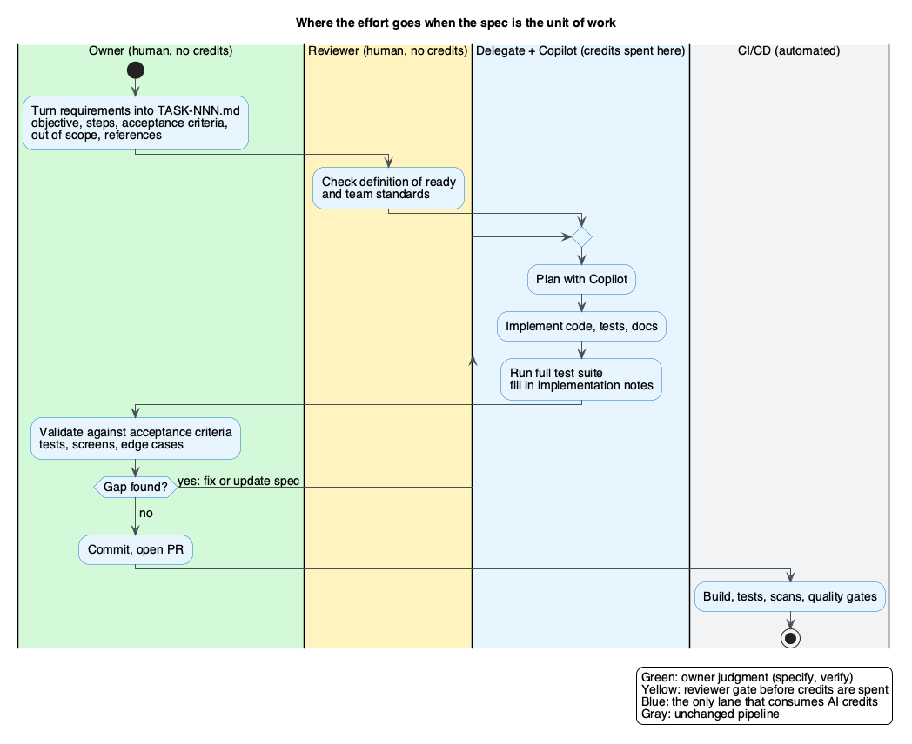

<!--
Medium metadata
Tags: Software Engineering, GitHub Copilot, AI, Spec Driven Development, Developer Productivity
Meta description: Some developers run out of Copilot credits while teammates end with credits to spare. Route the work through version-controlled task specs, not shared accounts.
-->

# Uneven Copilot credits? Make the spec the unit of work

*Some developers run out of Copilot credits while teammates end the period with credits to spare. A Markdown task spec beats shared accounts*


*By [Wallace Espindola](https://www.linkedin.com/in/wallaceespindola/), Solution Architect | [wallace.espindola@gmail.com](mailto:wallace.espindola@gmail.com) | [GitHub](https://github.com/wallaceespindola/)*

*I wrote this article with AI assistance, then reviewed, fact-checked and edited it myself.*

---

Here is a situation I suspect plenty of teams are in, even if nobody says it out loud. Two people sit next to each other, work on the same codebase, pick tickets from the same board, and have very different amounts of AI help available to them.

One still has most of this period's Copilot credits left. The other burned through theirs in the first week of a big refactor, or has no license at all because they joined after the contract was signed, or because they are a contractor. Both are expected to deliver at the same pace, and the leftover credits on the first person's account do nothing for the second.

Those leftover credits are capacity the company has already paid for. I don't think the answer is to buy more seats, and I am sure the answer is not to share accounts. My proposal is simpler and, I think, more interesting: let the developer with spare capacity implement the work, and let the developer without it own everything around the implementation. The thing that travels between them is a version-controlled Markdown file. The spec becomes the unit of work.

I wrote this up as a process proposal in [share-tokens-using-spec-driven-dev](https://github.com/wallaceespindola/share-tokens-using-spec-driven-dev), with a PRD, a task template and a worked example. This article is about why I think it works, and what it changes about the job.

## The AI gap inside one team

We talk a lot about AI access at the level of companies and countries. We talk much less about the gap inside a single team, probably because it is awkward. Nobody wants to say in standup that they are slower because their colleague has a better tool budget.

The gap is real, though, and it comes from how Copilot is usually bought. A company signs a contract with Microsoft or GitHub, and each licensed user works against a personal limit per billing period, either a per-user credit allowance or a per-user budget that admins set on the organization's pool. People use that capacity very differently. A developer who leans on agent mode for a few days of heavy refactoring can empty theirs early. A colleague who mostly uses inline suggestions, or who spent the sprint in meetings and design reviews, ends the period with credits to spare. Because each limit belongs to one user, the spare credits can't help the person who ran out. And some developers on the same team have no license at all.

From the company's side, that is paid capacity going unused next to people doing work by hand. Routing work to whoever still has credits gets more out of the same contract without buying anything extra.

Billing changes make the unevenness easier to see. GitHub moved Copilot to usage-based billing on June 1, 2026: [premium requests were replaced by a monthly allotment of GitHub AI Credits](https://github.blog/changelog/2026/04/27/github-copilot-is-moving-to-usage-based-billing/), metered by token consumption at each model's rate. That makes cost per task more visible and more variable. A heavy agent session on a large task costs more than a quick question, and the person holding the smaller allowance feels it first.

The same announcement says credits on business plans can be pooled across an organization, and admins can still cap spend per user on top of that pool. If your organization pools with no per-user caps, the credit argument gets weaker. Pooling still gives nothing to the person who has no seat, and it leaves open whose work deserves the spend. Those are team decisions, and teams need a way to make them that is better than whoever asks loudest.

So my question was practical. If the capacity exists somewhere on the team, how do you route work to it without making a mess?

## Why "can you run this through Copilot for me?" fails

The first thing people try is the obvious one. A developer without capacity messages a colleague who has some: "Hey, can you run this through Copilot for me? It's the order report thing, should be quick."

I understand the instinct, and I think it fails for predictable reasons.

The request lives in a chat message, so the context is whatever fit in a few lines. The delegate opens a Copilot session, pastes in the request, and the model starts guessing. Guessing is expensive: every clarifying round trip, every "actually, it also needs to be restartable," every regenerated file spends the delegate's credits on information the owner already had in their head.

Then the code comes back through the same chat, maybe as a snippet, maybe as a branch. Nobody wrote down which decisions Copilot made or why. When the session closes, the reasoning closes with it. Two weeks later, when the report job fails in a way nobody expected, the only record of intent is a chat thread and a Copilot conversation that lives on someone else's machine.

There is another cost. The owner never has to articulate what "done" means, so they cannot properly validate the result. They glance at it, it compiles, it looks plausible, and it ships. That is one way AI-generated code reaches production without anyone really owning it.



*On the left, the chat handoff: context is partial, clarification eats credits, and the reasoning disappears with the session. On the right, the spec handoff: the file is reviewed before anyone spends a credit, and the owner validates against written criteria.*

## Make the spec the unit of work

The fix I propose comes straight from spec-driven development, the approach that tools like [GitHub Spec Kit](https://github.com/github/spec-kit) are built around: write the intent down as a structured Markdown document first, then let an AI agent plan and implement from it.

Applied to uneven capacity, it looks like this. The owner, the developer with little or no Copilot capacity, writes a task file and commits it to the repo, something like `docs/backlog/TASK-042-order-summary-report.md`. A reviewer (a tech lead, an architect or another developer) checks it before anyone spends credits. Then a delegate with spare capacity picks it up, implements it with Copilot, runs the tests and fills in what they did. The owner validates the result, makes the final commit and opens the PR. CI runs exactly as it would for any other change.

What I am describing is spec-driven development stretched from one developer to a team. Spec Kit's flow sets a project constitution once, then takes each feature through specify, plan, tasks, implement and converge, and it supports Copilot as one of its agents. As written, one person can drive every one of those steps. I split them across people: the constitution becomes the team's architecture, coding and testing guides, specifying is the owner turning business requirements into intent, and the plan and tasks end up as the approved TASK file. Implementing happens in the delegate's Copilot session, and converging is the owner's validation loop. Spec Kit contributes that intent-first habit and a Markdown format that an agent and a colleague can both read. My addition is the handoff between steps.

Nobody transfers tokens. Nobody logs into anyone else's account. The delegate already has repository access, and nothing in the process grants access they did not have. The owner keeps responsibility for the outcome, which I think is the most important property of the whole thing.

The task file itself is plain. Here is the core of the example in the repo, trimmed:

```markdown
# TASK-042: Generate order summary report

## Objective
Generate the order summary report from normalized order records.

## Expected behavior
1. Load the report configuration.
2. Retrieve the eligible orders.
3. Generate the report.
4. Store the delivery metadata.

## Acceptance criteria
- [ ] The report is generated for all eligible orders.
- [ ] The job can be restarted after a failure.
- [ ] A failed run is recorded.

## Out of scope
- File transport
- Customer notification

## Implementation notes
Filled in by the delegate at handback.
```

It is deliberately plain. A person can read it, Copilot can read it, and a new team member can read it six months from now. The file lives in Git, links to the architecture and testing guides it depends on, and pairs with a GitHub issue so the board shows which tasks are waiting for a delegate.

One detail I like: delegates note their spare capacity on the board, something like "can take two tasks this sprint." Owners stop asking around in private messages. The routing problem becomes visible, which is the first step to making it fair.

## The parts that cost no credits are the parts that matter most

The whole proposal rests on one observation. Writing a good spec costs zero AI credits. So does reviewing it. So does validating the result against acceptance criteria. Implementation, the part in the middle, is where Copilot saves the most time and where credits actually get spent.

I would argue the same split describes where human judgment counts most in AI-assisted development in general, licenses or not.



*Only one lane spends AI credits. The owner's lane, specifying at the start and verifying at the end, is where the judgment lives.*

Think about what the owner does in this model. They turn a business requirement into concrete expected behavior. They decide what is out of scope, which is often the hardest call on a task and the one that keeps an agent from wandering into adjacent code. They write acceptance criteria that a test or a visible result can check. Then, when the work comes back, they verify it: run the tests, exercise the screens, try the edge cases they worried about when writing the spec.

That is design work and quality work. The developer without a Copilot seat ends up doing the part an AI agent handles worst and a team most needs a human to own.

The delegate's job also gets better. Instead of a vague chat request, they get a reviewed spec with references, inputs, constraints and a definition of done. Their session starts with the full context in one file, so fewer credits go to guessing. The PRD in the repo lists practices that help here: one task per fresh session, point Copilot at files instead of pasting them, plan before editing because a wrong plan caught early costs one request and a wrong implementation costs many, and stop to fix the task file when Copilot loops instead of retrying.

## How the developer role shifts

I think this process is a small preview of a bigger change. As agents get better at implementation, the scarce skills move to the edges of the work: specifying clearly at the start and verifying rigorously at the end.

Uneven capacity just makes that shift visible earlier. On a team using this process, the developer with no license spends their time on exactly those edges, and the developer with a full allowance spends part of theirs running well-specified tasks through an agent. Both are doing real engineering.

There is a side effect I like a lot. Writing specs that an agent can execute is a skill, and it compounds. An owner who writes ten TASK files learns to spot ambiguity before it costs anything. Their specs should get shorter and sharper. That skill transfers directly to the day they do get a Copilot seat, because the habits that make a spec good for a colleague's agent are the same habits that make it good for their own.

## The risks, and how the process answers them

The process has costs. Three risks are obvious, and they deserve straight answers.

### Deskilling

The worry: if owners never implement, they stop being able to. I take that seriously. My answer is partly in the scope rules. Not everything gets delegated. The PRD keeps one-line fixes, config changes, exploratory design work and production incidents with the owner. Delegation pays off for large, well-defined work such as new endpoints, test suites, mechanical refactors and boilerplate, which is also the work where hand-typing teaches the least.

The other part is validation. You cannot validate code you don't understand. The owner has to read the diff, run it and reason about failure modes. Step 10 of the process asks the owner to fix small issues themselves. That keeps their hands on the code.

### Delegates become a bottleneck

The worry: the few people with spare capacity get buried. This is why capacity goes on the board explicitly, and why the PRD suggests tracking tasks waiting for a delegate each sprint. A growing queue is a signal, either to split tasks smaller or to make the case for more capacity with actual data behind it. I would much rather a team argue about licenses from a visible queue than from frustration.

The definition of ready helps too. A reviewer approves a task only when the objective fits in a sentence or two, every acceptance criterion is checkable, out of scope is listed and the task is small enough for one session. As a rule of thumb, that means a PR one person can review in under an hour. Small, ready tasks should move through delegates quickly. Vague tasks are what clog the queue.

### Review fatigue

The worry: AI-generated PRs pile up and reviewers start rubber-stamping. This is a fair concern with or without delegation. The process adds structure in a few places. The spec is reviewed before implementation, so the PR reviewer already knows what the change is supposed to do. The delegate fills in implementation notes covering what changed, the decisions made and anything left open, so the reviewer is not reverse-engineering intent from a diff. The owner validates before the PR exists, so the reviewer is not the first human to check the result. And the size limit keeps each PR reviewable in one sitting.

Careful review is still needed. The difference is that the reviewer gets a spec, notes and a validated change instead of a pile of generated code.

## What I would watch if I tried this

I am describing a proposal and have no results to report, so I won't claim numbers I don't have. If I were piloting it, these are the signals I would track per sprint, as listed in the PRD:

- tasks delegated and merged
- iterations per task, where more than two usually means the task was not ready
- time from approval to merge, compared with similar tasks done by hand
- tasks waiting for a delegate

I would also watch something harder to measure: whether the specs get better over time. If owners are learning to write tighter tasks, the iteration count should drop, and the specs that reach `/docs` become useful documentation in their own right.

## Practical notes if you want to start

You don't need new tools. A few things make it smoother:

- A `.github/copilot-instructions.md` file with your stack, conventions and links to your architecture and testing guides. [GitHub documents this as the place for repository-wide custom instructions](https://docs.github.com/en/copilot/how-tos/configure-custom-instructions/add-repository-instructions), and it means every delegate starts from the same context.
- A shared prompt that tells Copilot how to execute a task file: plan, implement, run the tests, fill in the implementation notes. Every delegate then runs tasks the same way.
- A GitHub issue per task with a dedicated label. A delegate can also hand the issue to [Copilot cloud agent](https://docs.github.com/en/copilot/concepts/agents/coding-agent/about-coding-agent), which works in the background and opens a pull request. The usage counts against the delegate's allowance, and the owner validates the draft PR like any other result.
- Task files with synthetic examples only. No secrets, credentials or production data, ever. Use Copilot only within your company's approved AI policy.

The full PRD, the task template, a definition-of-ready checklist and the TASK-042 example are in the [repository](https://github.com/wallaceespindola/share-tokens-using-spec-driven-dev).

## Wrapping up

Uneven AI capacity inside a team is not going away soon. Budgets, contracts and plans will keep producing it. Here is what I think about it:

- More licenses help, though they leave open who owns the work and where intent is recorded.
- Sharing accounts is the wrong answer on every axis: security, auditability, policy.
- A chat request is a lossy handoff that spends someone else's credits on your missing context.
- A reviewed, version-controlled task spec routes implementation to whoever still has credits, which the company already paid for, while the owner keeps the parts that need judgment: specifying and verifying.
- Those are also the skills that matter more as agents get better, so the developer without a seat gets early practice in the part of the job that is growing.

I'd like to hear how your team handles this. Does everyone have the same AI budget, or have you seen the gap too? And if you've tried routing work to colleagues with spare capacity, what broke first? Let me know in the comments.

---

**Examples repository:** every example in this article (the PRD, the TASK-042 task spec, the team guides, the Copilot instructions, the prompt file and the diagrams) is in <https://github.com/wallaceespindola/share-tokens-using-spec-driven-dev>.

Need more tech insights?
Check out my GitHub, LinkedIn, and Speaker Deck.
Happy coding!

Wallace Espindola, Solution Architect

[GitHub](https://github.com/wallaceespindola/) · [LinkedIn](https://www.linkedin.com/in/wallaceespindola/)
