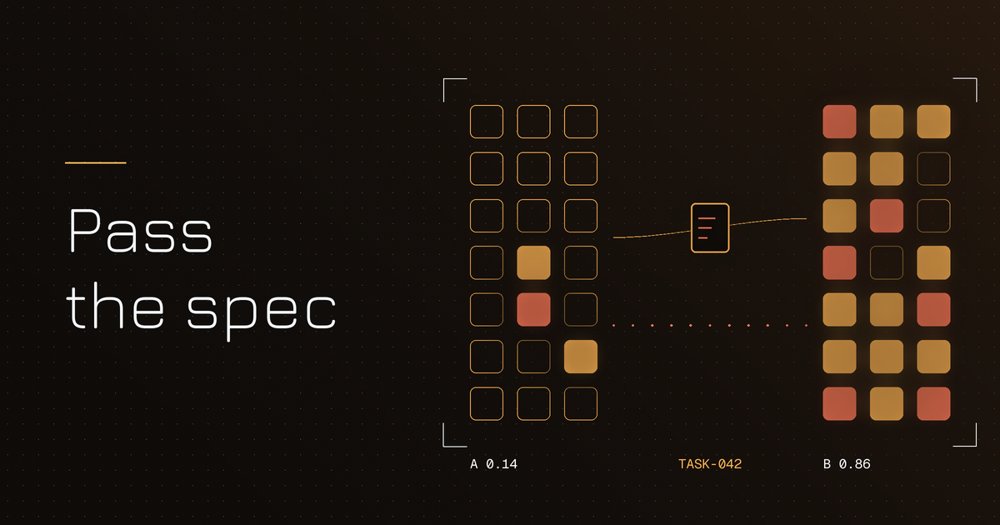
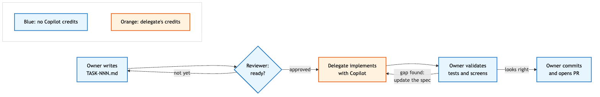

**Suggested subject line:** Your Copilot credits don't have to run out alone

*Preview text: The habit that spreads a team's AI capacity: write the ticket so Copilot can run it.*

---



# Write the ticket as if Copilot will read it

Hey folks,

Some team economics first. Most teams get Copilot through a company contract, and each developer works against a personal limit per billing period: a per-user credit allowance, or a per-user budget that admins set on the organization's pool. Then real life happens. One developer has a small limit and burns through it early in the period. Another sits on a seat with plenty left over, because this sprint they're mostly in meetings and code reviews. A third has no license at all.

Everyone has the same backlog. Only some of them have the tool. And the credits left on the quiet seat can't help the colleague who ran out, because each limit belongs to one person.

I wrote up a small proposal for this in a repo. This issue is the coffee-length version: the problem, the one habit that fixes most of it, and what to try on Monday.

## Credits are personal, the backlog isn't

GitHub's docs describe Copilot usage in organizations as measured in [AI credits](https://docs.github.com/en/copilot/concepts/billing-and-usage/organizations-and-enterprises), where each license adds credits to a shared pool and budget controls can be set per user, per cost center or per enterprise. That makes sense for billing. It also means that, inside one team, AI capacity behaves like something each person owns, while the work behaves like something the team owns. (If your org pools credits with no per-user caps, the credit side of this gets weaker. The colleague with no license is still stuck.)

Credits that go unused by the end of the period are capacity the company already paid for. If some of the team's work can be routed to the people who still have credits, the company gets more out of the same contract, without buying extra seats or a bigger limit for anyone.

The obvious workaround is the one people already use: "hey, can you run this through Copilot for me?" in a chat message. I don't like it, for a few reasons.

- The context lives in a chat thread, half of it in someone's head.
- The colleague with credits spends them on clarifying questions before Copilot writes a line of code.
- When it's done, the reasoning disappears with the Copilot conversation.
- Sooner or later someone suggests sharing a login, which is a hard no.

What I wanted was the smallest change that lets the person *without* capacity hand work to the person *with* it, safely, and without anyone touching anyone else's account.

## The habit: write the ticket as if an AI will read it

The proposal rests on one observation. Writing a good spec costs no AI credits. Validating the result costs no AI credits either. Implementation is the step where Copilot saves the most time.

So split the work along that line.

The owner (no license, or a small allowance) does the thinking and the checking. They write a task file, `docs/backlog/TASK-NNN-short-slug.md`, committed to the repo like any other doc. A reviewer approves it before anyone spends a credit. The delegate (someone with spare capacity) opens a fresh Copilot session, points it at the task file, implements, runs the tests, and fills in a short "implementation notes" section. Then the owner validates, commits, and opens the PR. No tokens change hands and no account gets shared, because the task file carries everything the delegate needs.



Only the orange box spends credits. Everything around it is plain engineering work that the owner was going to do anyway.

This is spec-driven development: you write the spec first, in Markdown that a person and an AI can both read, and the code follows from it. [GitHub Spec Kit](https://github.com/github/spec-kit) is the easiest way I know to try it. It works with Copilot (`uv tool install specify-cli`, then `specify init <project> --integration copilot`), and after a one-time constitution for the project, each feature goes through `/speckit-specify`, `/speckit-plan`, `/speckit-tasks`, `/speckit-implement` and `/speckit-converge`. The specs and task lists it produces are the same kind of file I'm describing here. What I'm adding is a social use for it. Once a ticket is good enough for Copilot to run without a conversation, it's good enough for *anyone's* Copilot to run.

## What a ticket like that looks like

Here's a trimmed version of the example task in the repo. It's ordinary Markdown:

```markdown
# TASK-042: Generate order summary report

## Objective
Generate the order summary report from normalized order records.

## Expected behavior
1. Load the report configuration.
2. Retrieve the eligible orders.
3. Generate the report.
4. Store the delivery metadata.

## Acceptance criteria
- [ ] The job can be restarted after a failure.
- [ ] A failed run is recorded.

## Out of scope
- File transport
- Customer notification
```

The full file also lists the tech stack, inputs, architecture constraints and references, and ends with an empty "Implementation notes" section for the delegate.

Two sections do most of the work. "Expected behavior" is a numbered list of concrete steps, so Copilot doesn't have to guess. "Out of scope" is the cheapest credit saver I know: it tells the model where to stop. A delegate's credits get wasted when the model has to improvise, and every line in a spec like this removes a bit of improvisation.

The other thing I like: the ticket outlives the chat. When the owner reviews the PR six weeks later, or someone new joins and wonders why the job is restartable, the answer is in `/docs`, next to the code.

## Where it doesn't pay off

Delegation has a fixed cost: write, review, hand off, validate. For a one-line fix or a config change, that overhead is bigger than the work. Same for exploratory work where the design is still open, or a production incident that needs someone on it right now.

It pays off for work that is large and well defined: a new endpoint or batch job with a clear spec, a test suite for existing code, a mechanical refactor across many files, the DTO-mapper-repository boilerplate nobody enjoys. And the rule of thumb in the proposal is to keep each task to roughly a PR one person can review in under an hour. If it's bigger, split it.

The same habits that make a delegate's credits go further also help the owner stretch a small allowance of their own: one task per fresh session, point Copilot at files instead of pasting them, and plan before you let it edit. A wrong plan caught early costs one request. A wrong implementation costs many.

## Try this on Monday

You don't need a new process to test the idea. Pick one piece of work and run it through once:

1. Pick one well-defined task from your backlog that you'd normally do by hand. It should have a clear outcome; leave open investigations for later.
2. Write it as `TASK-NNN-short-slug.md` with objective, expected behavior as numbered steps, testable acceptance criteria, and an "Out of scope" list. If you set up Spec Kit, `/speckit-specify` can draft the first version for you to edit. No secrets or production data in it.
3. Ask one colleague to review it before anything runs. If they have questions, Copilot would have had them too, so put the answers in the file.
4. Find a delegate with spare capacity and let them run it in a fresh Copilot session, then fill in the implementation notes.
5. Validate it yourself, commit, and open the PR. It goes through the same review and CI gates as any other change.

Then look at one number: how many back-and-forth iterations it took. One or two means the ticket was ready. More than that usually means the spec had gaps, which is useful to know even if you never delegate again.

## The repo

Everything is in a public repo, with the full proposal (roles, definition of ready, the 13-step process, the task template, and the recommended agents and MCP servers so every delegate uses the same setup):

**<https://github.com/wallaceespindola/share-tokens-using-spec-driven-dev>**

Start with `docs/spec/PRD-copilot-capacity-sharing.md`, then open `docs/backlog/TASK-042-order-summary-report.md` to see the template filled in.

It's a proposal, and I have no results to report yet. I'd like to hear how it holds up on your team.

## Wrapping up

Licenses and credits will probably stay uneven on most teams. The work can still reach whoever has capacity left. Write the ticket well enough that Copilot could run it without asking you anything, and suddenly it doesn't matter much whose Copilot does.

My question for you: on your team, who runs out of AI capacity first, and what do they do when it happens? Hit reply or drop a comment. I read every one.

**Examples repository:** every example in this article (the PRD, the TASK-042 task spec, the team guides, the Copilot instructions, the prompt file and the diagrams) is in <https://github.com/wallaceespindola/share-tokens-using-spec-driven-dev>.

Need more tech insights?
Check out my GitHub, LinkedIn, and Speaker Deck.
Happy coding!

Wallace Espindola, Solution Architect

GitHub: <https://github.com/wallaceespindola/>
LinkedIn: <https://www.linkedin.com/in/wallaceespindola/>
Email: <wallace.espindola@gmail.com>
