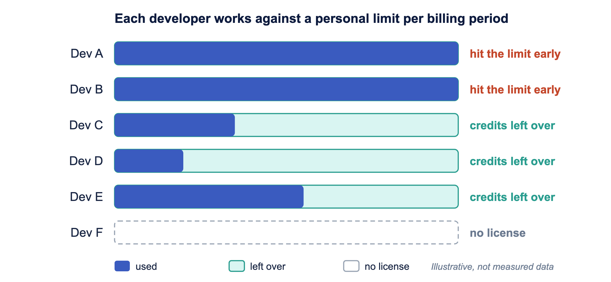
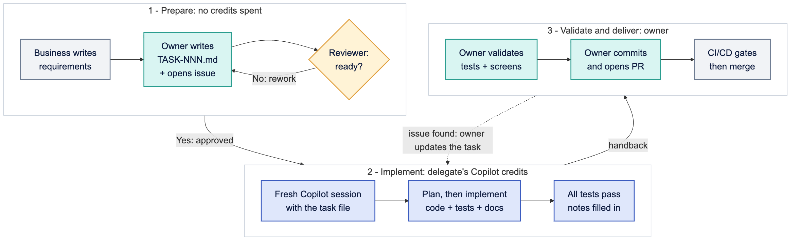
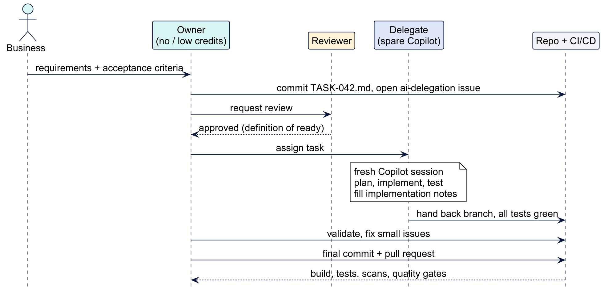

<!-- _class: lead -->
<!-- _backgroundColor: '#0d1b3e' -->
<!-- _color: '#ffffff' -->
<!-- _paginate: false -->

# Share Copilot Capacity, Not Accounts

## Spec-driven delegation for teams with uneven AI budgets

**Wallace Espindola**
Sr. Software Engineer / Solution Architect

<wallace.espindola@gmail.com>
linkedin.com/in/wallaceespindola | github.com/wallaceespindola

<!--
Hi, I'm Wallace. I'm going to present a proposal: a lightweight process for teams where AI coding assistance is unevenly distributed. There are no results in this talk, only the process and the reasoning behind it.
The short version: people with spare GitHub Copilot capacity implement tasks that colleagues without it have specified. The handoff is a Markdown spec in the repository. Nobody shares accounts or moves credits around.
Everything I show is in a public repo with the PRD, a sample task and a sample design doc. Link at the end.
-->

---

# The problem: one contract, uneven use

- Copilot usually comes through a **company contract** with Microsoft/GitHub
- Each developer works against a **personal limit** per billing period: a per-user allowance, or a per-user budget admins set on the pool
- Some developers **hit their limit early**, others **end the period with credits left**
- A limit belongs to **one user**: leftover credits do nothing for a colleague who ran out
- Some developers have **no license at all**

<!--
Most teams get Copilot through a company agreement with Microsoft or GitHub. Copilot now bills in GitHub AI Credits. On Business and Enterprise plans, the credits each license brings are pooled for the organization, and admins can set budgets per user, per cost center or for the whole enterprise. In practice each developer ends up working against a personal limit for the billing period.
Usage is uneven. Some people hit their limit early in the period, others finish it with credits to spare. Because the limit belongs to one user, those spare credits can't help the colleague who ran out. And some developers have no license yet.
If your organization pools credits with no per-user caps, the credit argument is weaker, but the case for developers without a license still holds. Check your own plan and settings.
-->

---

<!-- _class: diagram -->

# Credits the company already paid for



Routing work to people who still have credits gets more value from **the same contract**, without buying extra seats.

<!--
This picture is illustrative, not measured data from any team. Each bar is one developer's personal limit for the period. Some are used up, some are mostly empty, one developer has no license.
Unused credits are capacity the company has already paid for. If work can move to the people who still have credits, the team gets more out of the contract it already has, without extra seats or extra credits.
The rest of the talk is about how to move the work safely.
-->

---

# "Can you run this through Copilot for me?"

The informal version does not scale:

- The request lives in a **chat message**
- The context is **incomplete**, so Copilot guesses
- The delegate **burns credits** on clarifying questions
- The knowledge **disappears** with the Copilot conversation
- Nobody can see who is waiting on whom

<!--
Teams already do this informally. Someone pings a colleague and asks them to "just Copilot it".
It can work once. Then the context is missing, the delegate spends their own credits asking questions, and when it is done nothing is written down, so the next request starts from zero.
So the question is how to make the handoff cheap, explicit and repeatable.
-->

---

<!-- _class: lead -->
<!-- _backgroundColor: '#0d1b3e' -->
<!-- _color: '#ffffff' -->

# Key principle

## Nobody transfers tokens or shares accounts

The owner delegates a **task** to a colleague with Copilot capacity and stays responsible for validating and delivering it.

The **task file**, not the chat history, carries everything the delegate needs.

<!--
Licenses stay personal and nobody logs into someone else's account. What moves is a piece of work, the same way you would hand a ticket to a colleague.
And the handoff medium is a file in the repo, which a human or an AI can read equally well.
-->

---

# Why this split works

| Costs **no** AI credits | Where Copilot **saves the most time** |
|---|---|
| Understanding the requirement | Writing the implementation |
| Writing a clear spec | Generating the test suite |
| Reviewing the spec | Boilerplate, mappers, migrations |
| Validating the result | Mechanical refactors across files |

**Owner:** thinking and checking. **Delegate:** spends credits only where they pay off.

<!--
Writing a good spec and validating the result are human work. They cost zero credits. Implementation is where Copilot helps most.
So the owner keeps the parts that need judgement and context, and the delegate spends credits only on the part that benefits most from AI.
-->

---

# Spec-driven development, team edition

| GitHub Spec Kit step | In this process |
|---|---|
| `/speckit-constitution` (once) | Team standards in `/docs`: architecture, coding, testing guides |
| `/speckit-specify` | Business requirements, written up by the **owner** |
| `/speckit-plan` + `/speckit-tasks` | The **approved** `TASK-NNN.md` file |
| `/speckit-implement` | The **delegate's** Copilot session |
| `/speckit-converge` | The **owner's** validation loop |

Copilot setup: `uv tool install specify-cli` then `specify init <project> --integration copilot`

<!--
This process is spec-driven development, the GitHub Spec Kit flow, with the steps split across people.
In Spec Kit you write the constitution once, then for each feature you run specify, plan, tasks, implement and converge.
Here the constitution is the team's standards in /docs. Specify is the business requirements, written up by the owner. Plan and tasks end up as the approved task file. Implement is the delegate's Copilot session, and converge is the owner's validation loop.
Spec Kit supports Copilot directly: install the specify CLI with uv and run specify init with the Copilot integration. You can also follow the same flow by hand with plain Markdown files, which is what the sample repo does.
-->

---

# Four roles

| Role | Who | Responsible for |
|---|---|---|
| **Business** | Product owner or analyst | Requirements and acceptance criteria |
| **Owner** | Dev with no license or a used-up limit | Writing the task, validating, final commit and PR |
| **Reviewer** | Architect, tech lead or another dev | Approving the task **before** any credits are spent |
| **Delegate** | Dev with Copilot and credits to spare | Implementing with Copilot, including tests and docs |

<!--
Four roles. One person can hold different roles on different tasks: today's owner can be next sprint's delegate.
Note the reviewer's position: before any credits are spent. A bad spec caught in review costs nothing. A bad spec caught after implementation costs the delegate's credits and everyone's time.
And ownership never moves. The owner commits and opens the PR.
-->

---

<!-- _class: diagram -->

# The flow



<!--
Three stages.
Prepare: business requirements, the owner writes the task file and opens an issue, the reviewer checks it against the definition of ready. No credits spent yet.
Implement: the delegate opens a fresh Copilot session with the task file, plans, implements, runs the full test suite, fills in implementation notes.
Validate and deliver: the owner validates, fixes small issues, commits and opens the PR. CI/CD runs as usual. If something bigger is wrong, the owner updates the task file and it goes back to the delegate.
-->

---

<!-- _class: diagram -->

# Who talks to whom



<!--
Same flow, seen as messages. Two things to notice.
First, everything that matters goes through the repository: the task file, the branch, the PR. Chat is for coordination only.
Second, the owner is at both ends. They start the task and they finish it.
-->

---

# Anatomy of a task file

```markdown
# TASK-042: Generate order summary report
Status: Approved   Owner: <name>   Reviewer: <name>   Delegate: <name>

## Objective
Generate the order summary report from normalized order records.

## Expected behavior
1. Load the report configuration.
2. Retrieve the eligible orders.
3. Generate the report.
4. Store the delivery metadata.

## Acceptance criteria
- [ ] The report is generated for all eligible orders.
- [ ] The job can be restarted after a failure.
- [ ] A failed run is recorded.

## Out of scope
- File transport, customer notification

## Implementation notes   (filled in by the delegate at handback)
```

<!--
This is the sample task from the repo, trimmed for the slide. The full version also lists the tech stack, inputs, architecture constraints and references to ARCHITECTURE.md, TESTING_GUIDE.md and a design doc.
The steps are concrete and the criteria can be checked. The out of scope list stops Copilot from wandering into work nobody asked for.
The implementation notes section is how knowledge comes back from the delegate.
-->

---

# Definition of ready

The reviewer approves only when **all** of these hold:

- Objective fits in one or two sentences
- Each expected behavior is a **concrete step**, not a wish
- Each acceptance criterion is **checkable** by a test or a visible result
- **Out of scope** is listed
- Every referenced doc **exists and is current**
- Input/output **examples** where the format matters
- **No secrets**, credentials or production data
- Small enough for **one session** (a PR one person reviews in under an hour)

<!--
A delegate's credits are wasted when Copilot has to guess. This checklist is what stops that.
The size rule is a rule of thumb: if one person can't review the PR in under an hour, split the task.
The reviewer can be another developer. It doesn't need to be an architect every time, but it does need to be someone who did not write the task.
-->

---

# What to delegate, what to keep

| Delegate | Keep with the owner |
|---|---|
| New endpoints, services or jobs with a clear spec | One-line fixes and config changes |
| Test suites for existing code | Exploratory work, design still open |
| Mechanical refactors and migrations | Production incidents that need someone now |
| Boilerplate: DTOs, mappers, repositories | Changes needing access the delegate lacks |
| Docs generated from existing code | |

Delegation has a fixed overhead. It pays off when the work is **large and well defined**.

<!--
Writing a task, a review, a handoff and a validation all take time. For a one-line fix, that overhead is bigger than the work.
Delegate the big, well-defined chunks. Keep the small, the urgent and the fuzzy.
-->

---

# Naming and tracking

- One file per task: `docs/backlog/TASK-NNN-short-slug.md`
- `NNN` is zero-padded and **never reused**
- Heading repeats ID and title: `# TASK-042: Generate order summary report`
- Each task gets a GitHub issue labeled **`ai-delegation`** linking the file
- The issue board shows what waits for a delegate and who took what
- Delegates post their capacity: *"can take 2 tasks this sprint"*

<!--
The conventions are deliberately plain: a predictable file name, a label and the issue board.
With the capacity note, delegates say up front how much they can take, so owners know who to ask. The "2 tasks" is an example of what someone might write, not a target.
-->

---

# Spend credits well

- **One task per session**, started fresh: long sessions carry old context
- Point Copilot at files (`#file`, `#codebase`) instead of pasting them
- Use a **shared `implement-task` prompt** so nobody re-explains conventions
- **Plan before editing**: a wrong plan costs one request, a wrong implementation many
- Included models for routine steps, **more expensive models only for the hard parts**
- Copilot stuck in a loop? **Stop and fix the task file**

<!--
The delegate's credits are the scarce resource, so each session should get as far as possible with as few requests as possible.
On models: per-model credit rates change, so check the current Copilot docs rather than trusting a number on a slide.
These tips also help owners make their own limited allowance last.
-->

---

# Repository setup

| Asset | Location |
|---|---|
| Custom instructions | `.github/copilot-instructions.md` |
| Path instructions | `.github/instructions/*.instructions.md` |
| Guidance for other agents | `AGENTS.md` |
| `implement-task` prompt | `.github/prompts/implement-task.prompt.md` |
| Custom agents | `.github/agents/*.agent.md` |
| Skills | `.github/skills/<name>/SKILL.md` |

Every delegate gets the **same setup** from the repo.

<!--
Custom instructions hold the stack, conventions and links to ARCHITECTURE.md, CODING_GUIDE.md and TESTING_GUIDE.md. They are loaded into every Copilot request.
The implement-task prompt reads a task file, plans, implements, runs the tests and fills in the implementation notes.
A custom agent can act as a reviewer that checks the definition of ready before a human looks at it.
-->

---

# Public agents, skills and MCP servers

**Workflow and agents**

- **GitHub Spec Kit**: `/speckit-constitution`, `/speckit-specify`, `/speckit-plan`, `/speckit-tasks`, `/speckit-implement`, `/speckit-converge`
- **Copilot agent mode** in the IDE, **Copilot coding agent** on the issue, **Copilot code review** on the PR
- **awesome-copilot**, **anthropics/skills**, **addyosmani/agent-skills**

**MCP servers**

- **GitHub MCP**: issue, linked PRs, CI results
- **Context7**: current library docs, no outdated APIs
- **Playwright MCP**: drives the UI during validation

<!--
All public. Spec Kit is the spec-driven development toolkit this process is based on. Its commands produce and consume the same kind of Markdown specs as our task files.
Copilot coding agent: the delegate can assign the issue to Copilot, which opens a draft PR in the background. The credits are charged to the delegate. The owner validates the draft PR as usual.
From the skill collections, pick what fits your stack and copy it into the repo. Don't install everything.
-->

---

# Guardrails

- Delegates **already have repository access**: nobody gains access they did not have
- Task files hold **synthetic examples**, never secrets or production data
- Copilot runs only within the company's **approved AI policy** (public code filtering, content exclusions)
- Delegated work passes the **same review, CI/CD and quality gates** as any other change
- `/docs` is the source of truth, **not** Copilot conversations

<!--
Expect security and management to ask about this, so it gets its own slide.
Nothing in this process changes who can see what, and nothing bypasses the pipeline. If your policy forbids something, this process doesn't make it allowed.
-->

---

# Is it working? Track per sprint

| Metric | What it tells you |
|---|---|
| Tasks delegated and merged | Is the process being used? |
| Iterations per task | More than two usually means the task was not ready |
| Approval to merge time | Compare with similar tasks done by hand |
| Tasks waiting for a delegate | Growing queue: more capacity or smaller tasks |

<!--
I'm not going to show numbers, because this is a proposal and I don't have results to share yet. These are the measures I'd track from the first sprint.
Iterations per task is the most useful early signal. If tasks keep bouncing back, fix the definition of ready, not the delegates.
-->

---

# Key takeaways

- Share **work**, not accounts or tokens
- **Spec-driven development** with the steps split across people
- The **spec** is the handoff, committed in the repo
- **Owners think and check**, delegates spend credits on implementation
- A reviewer gate **before** credits are spent
- Same PR, CI/CD and quality gates as every other change

<!--
My main suggestion: put a definition of ready in front of your Copilot credits.
Even teams where everyone has a license can use this. Clear task files make any AI session cheaper and any human handoff easier.
-->

---

<!-- _class: lead -->
<!-- _backgroundColor: '#0d1b3e' -->
<!-- _color: '#ffffff' -->

# Resources

**Repo (PRD + sample task + design doc):**
github.com/wallaceespindola/share-tokens-using-spec-driven-dev

**GitHub Spec Kit:** github.com/github/spec-kit

**Wallace Espindola**
<wallace.espindola@gmail.com>
linkedin.com/in/wallaceespindola | github.com/wallaceespindola

*Thanks! Questions?*

<!--
The repo has the full PRD, including the 13-step process, the task template and the recommended tools, plus TASK-042 and its design doc as a worked example.
Feedback welcome, especially if you try this with your team. Thanks.
-->
