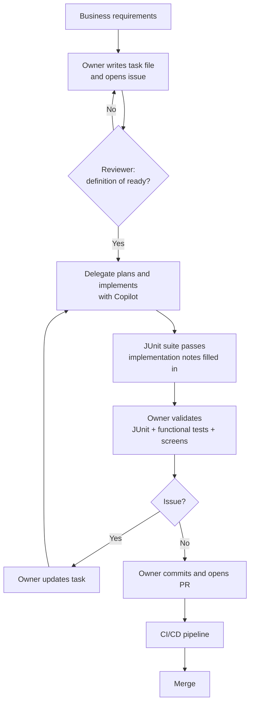

# PRD: Sharing Copilot capacity through task specs

Author: Wallace Espindola (<wallace.espindola@gmail.com>) · [LinkedIn](https://www.linkedin.com/in/wallaceespindola/) · [GitHub](https://github.com/wallaceespindola/)
Status: Proposal

## 1. Summary

Some developers on the team have GitHub Copilot capacity to spare and others have little or none. This process lets the second group hand implementation work to the first. The handoff is a Markdown task spec committed to the repository (spec-driven development, Spec Kit style), which a person or an AI can read equally well.

The idea rests on one observation: writing a good spec and validating the result cost no AI credits, while implementation is where Copilot saves the most time. So the owner does the thinking and the checking, and the delegate spends credits only on the part that benefits most.

## 2. Problem

Teams usually get Copilot through a company contract with Microsoft/GitHub where each developer works against a personal limit per billing period: a per-user credit allowance, or a per-user budget that admins set on top of the organization's pool. Usage is uneven. Some developers hit their limit early, and others end the period with credits left over. A limit belongs to one user, so leftover credits do nothing for colleagues who ran out. Some developers have no license at all.

(GitHub's Business and Enterprise plans pool the credits each license brings at the billing-entity level, and admins can cap spend per user, cost center or enterprise. Where credits are pooled with no per-user caps, the credit argument is weaker, but the case for developers without a license still holds.)

Unused credits are capacity the company has already paid for. Routing work to the people who still have credits gets more value out of the same contract, without buying extra seats or credits.

Asking a colleague informally ("can you run this through Copilot for me?") does not scale. The request lives in a chat message, the context is incomplete, the delegate burns credits on clarifying questions, and the knowledge disappears with the Copilot conversation.

## 3. Key principle

Nobody transfers tokens or shares accounts. The owner delegates a task to a colleague who has Copilot capacity and keeps responsibility for validating the result and delivering it. The task file, not the chat history, carries everything the delegate needs.

## 4. Roles

| Role | Who | Responsible for |
|------|-----|-----------------|
| Business | Product owner or analyst | Requirements and acceptance criteria |
| Owner | Developer with no Copilot license or a limited allowance | Writing the task, validating the result, final commit and PR |
| Reviewer | Architect, tech lead or another developer | Approving the task before any credits are spent |
| Delegate | Developer with Copilot and enough credits for the task | Implementing the task with Copilot, including tests and docs |

## 5. Goals

- Owners get AI-assisted implementation without needing their own Copilot capacity.
- Credits that would otherwise go unused at the end of a billing period go into real work.
- The team spends its total Copilot capacity on the work where it saves the most time.
- The repository (`/docs`) is the source of truth. Copilot conversations are not.
- Delegated work goes through the same review, CI/CD and quality gates as any other change.

## 6. Non-goals

- Sharing or transferring Copilot accounts, licenses or credits.
- Changing existing CI/CD, review or quality-gate rules.
- Replacing normal pair programming or code review.

## 7. What to delegate

Delegation has a fixed overhead: writing the task, a review, a handoff and a validation. It pays off when the implementation is large and well defined.

| Delegate | Keep with the owner |
|----------|---------------------|
| New endpoints, services or jobs with a clear spec | One-line fixes and config changes |
| Test suites for existing code | Exploratory work where the design is still open |
| Mechanical refactors and migrations across many files | Production incidents that need someone on call now |
| Boilerplate: DTOs, mappers, repositories, migrations | Changes that need access the delegate does not have |
| Documentation generated from existing code | |

## 8. Definition of ready

A delegate's credits are wasted when Copilot has to guess. The reviewer approves a task only when all of these hold:

- [ ] The objective fits in one or two sentences.
- [ ] Each expected behavior is a concrete step, not a wish.
- [ ] Each acceptance criterion can be checked by a test or a visible result.
- [ ] Out of scope is listed, so Copilot does not wander.
- [ ] Every referenced doc exists and is current.
- [ ] Input and output examples are included where the format matters.
- [ ] The task contains no secrets, credentials or production data.
- [ ] The task is small enough for one session (as a rule of thumb, a PR that one person can review in under an hour). Larger work is split into several tasks.

## 9. Task naming and tracking

- One file per task: `docs/backlog/TASK-NNN-short-slug.md`, for example `TASK-042-order-summary-report.md`.
- `NNN` is a zero-padded sequence number that is never reused.
- The slug names the outcome in a few lowercase words.
- The task's heading repeats the ID and title: `# TASK-042: Generate order summary report`.
- Each task has a matching GitHub issue labeled `ai-delegation` that links the file. The issue board shows which tasks are waiting for a delegate and who has taken which.
- Delegates note their available capacity on the board (for example "can take 2 tasks this sprint"), so owners know who to ask instead of asking around.

## 10. Process

| # | Role | Step |
|---|------|------|
| 1 | Business | Write the requirements and acceptance criteria, preferably in the existing `/docs/specs` documentation. |
| 2 | Owner | Write the task file from the template and open its `ai-delegation` issue. |
| 3 | Reviewer | Check the task against the definition of ready and the architecture, security, integration, coding and testing standards. Approve it or send it back. |
| 4 | Owner | Pick a delegate who has capacity on the board and record their name in the task. |
| 5 | Delegate | Start a new Copilot session with the task file and the docs it references as context. Use the shared `implement-task` prompt (section 12). |
| 6 | Delegate | Plan first, then implement: code, automated tests and documentation updates. |
| 7 | Delegate | Run the full JUnit suite. Hand the work back only when the new tests and all existing tests pass. |
| 8 | Delegate | Fill in the task's "Implementation notes": what changed, decisions made, anything left open. |
| 9 | Owner | Validate the implementation with JUnit, functional or simulation tests, the affected screens and any other checks that apply. |
| 10 | Owner | Fix small issues yourself. For anything bigger, update the task file and ask the delegate for another iteration. |
| 11 | Owner | Commit the validated implementation and open the pull request. |
| 12 | CI/CD | Run the full pipeline: build, tests, security scans and quality gates. The PR merges only if all of them pass. |
| 13 | Team | Move what is worth reusing from the implementation notes into `/docs`. |

## 11. Flow



## 12. Using credits well

The delegate's credits are the scarce resource, so each session should get as far as possible with as few requests as possible.

- One task per session, started fresh. Long sessions carry old context and cost more per request.
- Point Copilot at the files (`#file`, `#codebase`) instead of pasting their content.
- Use the shared `implement-task` prompt so every delegate runs tasks the same way and nobody re-explains the conventions.
- Plan with Copilot before letting it edit. A wrong plan caught early costs one request. A wrong implementation costs many.
- Use the included models for routine steps (boilerplate, renames, simple tests) and switch to a more expensive model only for the hard parts. Check the current per-model credit rates in the Copilot docs, since they change.
- When Copilot gets stuck in a loop, stop and fix the task file instead of retrying.

The same practices help owners make their own limited allowance last.

## 13. Recommended agents, skills and tools

All of these are public. Install them in the repository so every delegate uses the same setup.

### Repository setup

| Asset | Location | Purpose |
|-------|----------|---------|
| Custom instructions | `.github/copilot-instructions.md` | Stack, conventions and links to `docs/ARCHITECTURE.md`, `docs/CODING_GUIDE.md` and `docs/TESTING_GUIDE.md`. Loaded into every Copilot request. |
| Path instructions | `.github/instructions/*.instructions.md` | Rules for specific paths, for example tests or migrations. |
| `AGENTS.md` | Repository root | The same guidance for other coding agents. |
| `implement-task` prompt | `.github/prompts/implement-task.prompt.md` | Reads a task file, plans, implements, runs the tests and fills in the implementation notes. |
| Custom agents | `.github/agents/*.agent.md` | Specialized personas, such as a test writer or a reviewer that checks the definition of ready. |
| Skills | `.github/skills/<name>/SKILL.md` | Reusable procedures in the open Agent Skills format. |

### Agents and skills

- [GitHub Spec Kit](https://github.com/github/spec-kit). The spec-driven development toolkit this process is based on. It supports Copilot (`specify init . --integration copilot`) and adds `/speckit-constitution`, `/speckit-specify`, `/speckit-plan`, `/speckit-tasks`, `/speckit-implement` and `/speckit-converge`. The constitution maps to the team standards in `/docs`, specify to the business requirements, plan and tasks to the approved task file, implement to the delegate's session and converge to the owner's validation loop.
- Copilot agent mode (VS Code, JetBrains). Edits across files, runs the build and tests, and iterates on failures. This is the delegate's main tool.
- Copilot cloud agent. A delegate can assign the task's GitHub issue to Copilot, which works in the background and opens a draft PR. Sessions also use GitHub Actions minutes; check your organization's billing setup to see whose credits a session uses. The owner then validates the draft PR as in step 9.
- Copilot code review. A first automated review on the PR before the human review.
- [awesome-copilot](https://github.com/github/awesome-copilot). Community custom agents, instructions, prompts and skills, including Java, Spring Boot and JUnit ones. Pick what fits and copy it into the repository.
- [anthropics/skills](https://github.com/anthropics/skills) and [addyosmani/agent-skills](https://github.com/addyosmani/agent-skills). Skills in the open Agent Skills format, for example spec-driven development, test-driven development and code review.

### MCP servers

- [GitHub MCP server](https://github.com/github/github-mcp-server). Lets Copilot read the task's issue, linked PRs and CI results.
- [Context7](https://github.com/upstash/context7). Current documentation for Spring Boot, PostgreSQL drivers and other libraries, so Copilot does not write against outdated APIs.
- [Playwright MCP](https://github.com/microsoft/playwright-mcp). Drives the UI to check screens, which helps both the delegate and the owner during validation.

## 14. Task template (example)

```markdown
# TASK-042: Generate order summary report

Status: Draft | Approved | In progress | In validation | Done
Owner: <name>
Reviewer: <name>
Delegate: <name>
Issue: <link>

## Objective
Generate the order summary report from normalized order records.

## Tech stack
- Java 25
- Spring Boot
- PostgreSQL
- Kafka where required

## Inputs
- Report configuration
- Order records

## Expected behavior
1. Load the report configuration.
2. Retrieve the eligible orders.
3. Generate the report.
4. Store the delivery metadata.

## Architecture constraints
- Follow ../ARCHITECTURE.md.
- Follow ../CODING_GUIDE.md.
- Do not bypass the defined service boundaries.

## Acceptance criteria
- [ ] The report is generated for all eligible orders.
- [ ] The job can be restarted after a failure.
- [ ] A failed run is recorded.
- [ ] Unit tests cover the new code.
- [ ] Integration tests cover the end-to-end flow.

## Out of scope
- File transport
- Customer notification

## References
- ../ARCHITECTURE.md
- ../TESTING_GUIDE.md
- ../specs/report-generation/design.md

## Implementation notes
Filled in by the delegate at handback.
- Changed:
- Decisions:
- Open questions:
```

A filled-in copy of this example is in [`docs/backlog/TASK-042-order-summary-report.md`](../backlog/TASK-042-order-summary-report.md).

## 15. Security and policy

- Delegates already have repository access. Nothing in this process gives anyone access they did not have.
- Task files never contain secrets, credentials or production data. Use synthetic examples.
- Copilot is used only within the company's approved AI policy and settings, such as public code filtering and content exclusions.

## 16. Measuring it

Track a few numbers per sprint to see whether the process pays off:

- Tasks delegated and merged
- Iterations per task (more than two usually means the task was not ready)
- Time from approval to merge, compared with similar tasks done by hand
- Tasks waiting for a delegate (a growing queue means the team needs more capacity or smaller tasks)

## 17. Acceptance criteria for this process

- An approved task file that meets the definition of ready is committed before any credits are spent.
- The owner validates the work, makes the final commit and opens the PR.
- Delegated work passes the same review, CI/CD and quality gates as any other change.
- Everything needed to understand a task is in `/docs`. None of it exists only in a Copilot conversation.
