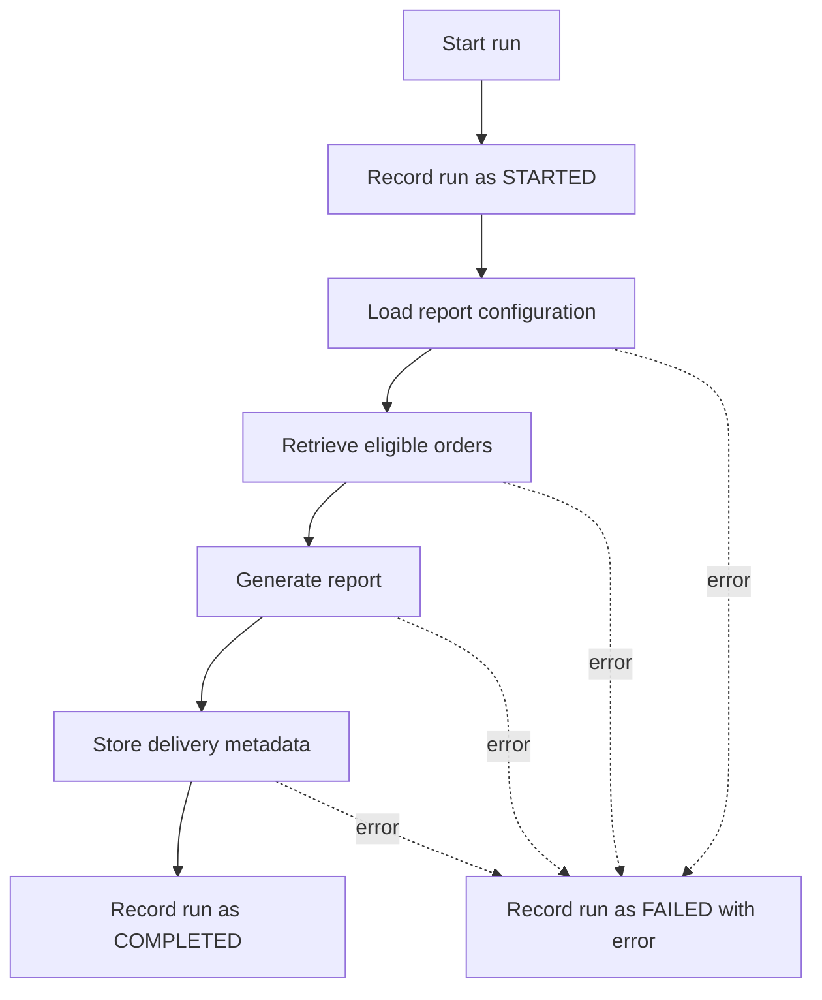

# Report generation: design

Example content for [TASK-042](../../backlog/TASK-042-order-summary-report.md).

## Flow

## Data

| Table | Purpose |
|-------|---------|
| `report_configuration` | Which orders a report includes and how it is formatted |
| `orders` | Normalized order records (input, read only) |
| `report_run` | One row per run: ID, configuration, status, start and end time, error |
| `report_delivery` | Delivery metadata for each generated report |

## Restart

Before generating, the job checks `report_run` for a completed run with the same configuration and period. If one exists, the job does not generate the report again. A failed or interrupted run is retried from the start.

## Out of scope

- Transporting the report file to its destination
- Notifying customers
